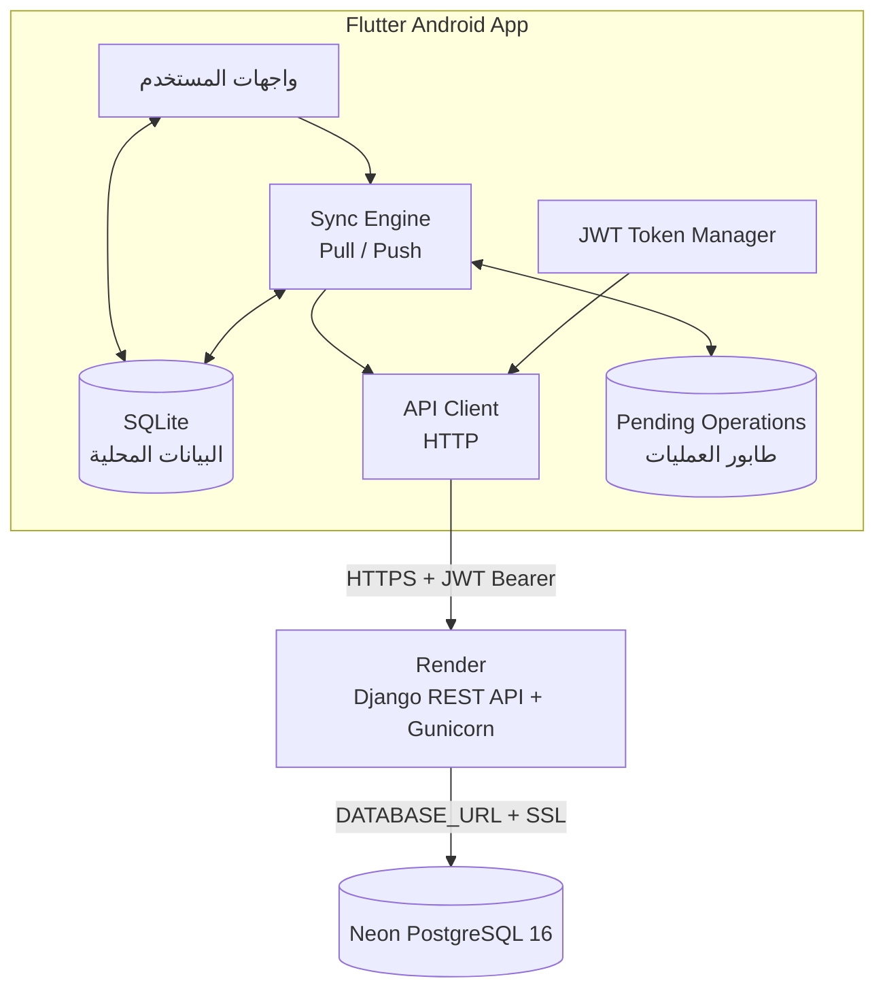
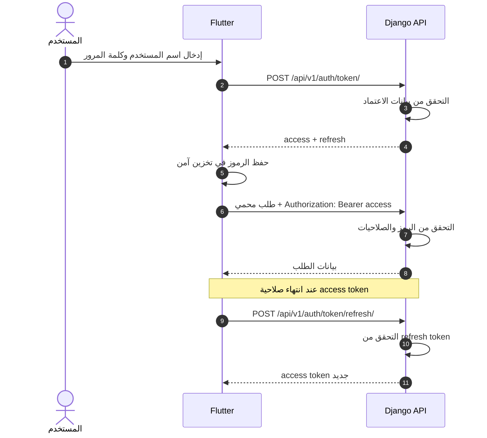
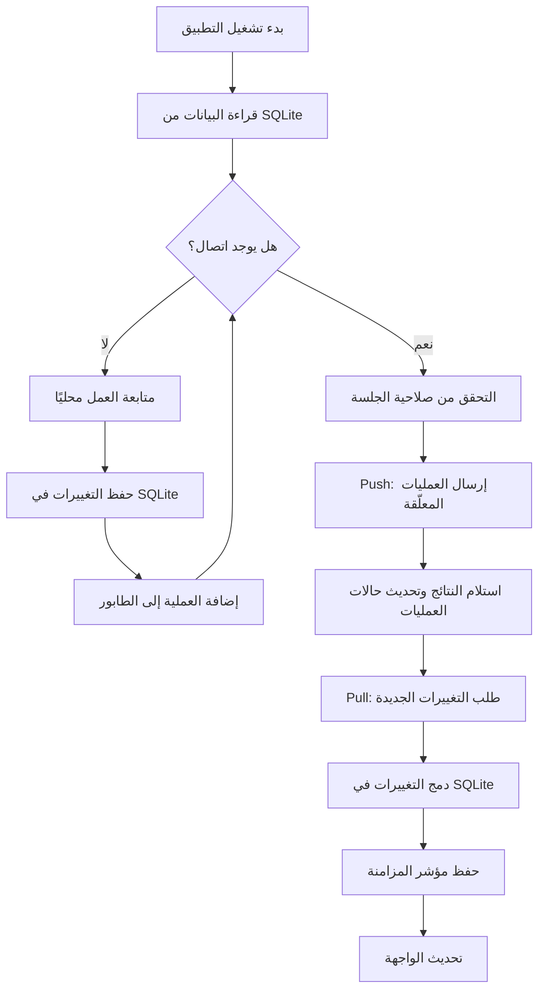
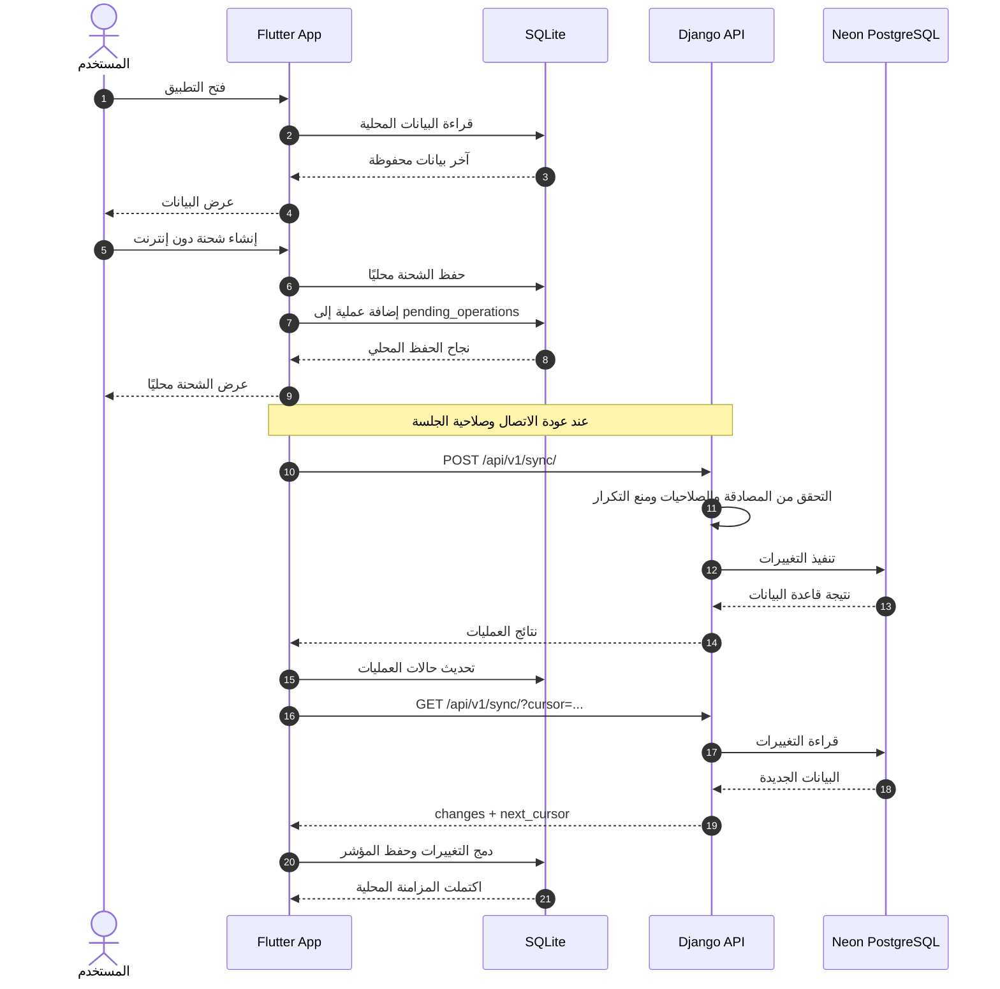

# الوثيقة التقنية لتطبيق Flutter Android
## Goods Transportation System — Offline-First Architecture

> **الغرض:** توثيق البنية التقنية لتطبيق Android وربطه بنظام إدارة نقل البضائع الحالي عبر Django REST API، مع دعم العمل دون اتصال ومزامنة البيانات عند عودة الاتصال.

| البند | التفاصيل |
|---|---|
| المشروع | Goods Transportation System |
| تطبيق الهاتف | Flutter — Android |
| الخادم الخلفي | Django REST API + Gunicorn |
| الاستضافة | Render |
| قاعدة البيانات المركزية | Neon PostgreSQL 16 |
| قاعدة البيانات المحلية | SQLite |
| المصادقة | JWT Bearer Tokens |
| نمط العمل | Offline-First Synchronization |

---

## المحتويات

1. [البنية المعمارية](#1-البنية-المعمارية)
2. [التواصل مع API](#2-التواصل-مع-api)
3. [المصادقة باستخدام JWT](#3-المصادقة-باستخدام-jwt)
4. [دورة المزامنة Offline-First](#4-دورة-المزامنة-offline-first)
5. [تصميم SQLite المحلي](#5-تصميم-sqlite-المحلي)
6. [هيكل مشروع Flutter](#6-هيكل-مشروع-flutter)
7. [إعدادات Render](#7-إعدادات-render)
8. [حالة المكونات الخلفية](#8-حالة-المكونات-الخلفية)
9. [متطلبات الأمان](#9-متطلبات-الأمان)
10. [تدفق البيانات الكامل](#10-تدفق-البيانات-الكامل)
11. [خطة التنفيذ والاختبار](#11-خطة-التنفيذ-والاختبار)
12. [الخلاصة](#12-الخلاصة)

---

## 1. البنية المعمارية

### 1.1 المخطط العام



### 1.2 مسؤوليات كل مكوّن

| المكوّن | المسؤوليات الرئيسية | ملاحظات |
|---|---|---|
| **Flutter UI** | عرض الشحنات والرحلات والعملاء والنماذج | واجهة Android |
| **SQLite** | حفظ البيانات المحلية وتوفير الوصول دون إنترنت | المصدر المحلي لواجهات التطبيق |
| **Sync Engine** | تنظيم المزامنة الكاملة والتزايدية وإرسال العمليات | يتعامل مع حالات الفشل وإعادة المحاولة |
| **Pending Operations** | حفظ العمليات التي لم يؤكد الخادم تنفيذها | لكل عملية معرّف فريد |
| **JWT Token Manager** | حفظ رموز المصادقة وتجديدها | يجب استخدام تخزين آمن |
| **API Client** | إرسال طلبات HTTP وإضافة الرؤوس ومعالجة الأخطاء | لا يتجاوز صلاحيات الخادم |
| **Django REST API** | المصادقة والتحقق من الصلاحيات وتنفيذ العمليات | الخادم المرجعي للبيانات المشتركة |
| **Render** | تشغيل خدمة Django | خدمة الاستضافة |
| **Neon PostgreSQL** | تخزين البيانات المركزية | الاتصال عبر TLS/SSL وفق إعدادات المزود |

### 1.3 مبدأ العمل

- **القراءة:** يعرض التطبيق البيانات المحفوظة محليًا، ويمكنه تحديثها من الخادم عند الاتصال.
- **الكتابة:** تُحفظ التغييرات المحلية أولًا، ثم توضع في طابور المزامنة.
- **المزامنة:** يرسل التطبيق العمليات المعلّقة ويستقبل التغييرات من الخادم.
- **اتساق البيانات:** الخادم هو المرجع للبيانات المشتركة، ويجب تعريف قواعد واضحة لحل التعارضات.

---

## 2. التواصل مع API

### 2.1 المسارات الأساسية

| العملية | الطريقة | المسار | الغرض |
|---|---|---|---|
| تسجيل الدخول | `POST` | `/api/v1/auth/token/` | الحصول على رموز JWT |
| تجديد رمز الوصول | `POST` | `/api/v1/auth/token/refresh/` | طلب رمز وصول جديد |
| جلب التغييرات | `GET` | `/api/v1/sync/?cursor=<last_cursor>` | المزامنة التزايدية |
| إرسال العمليات | `POST` | `/api/v1/sync/` | رفع العمليات المحلية |
| قائمة الشحنات | `GET` | `/api/v1/modules/transport/shipments/` | مثال لمسار محمي |
| مخطط OpenAPI | `GET` | `/api/v1/schema/` | الاطلاع على مخطط API |

> **تنبيه:** يجب اعتماد المسارات وبنية الاستجابات الفعلية من الخادم ومخطط OpenAPI. الأمثلة التالية توضيحية وليست بديلًا عن اختبار API.

### 2.2 تسجيل الدخول

**الطلب**

```http
POST /api/v1/auth/token/
Content-Type: application/json
```

```json
{
  "username": "driver1",
  "password": "YOUR_PASSWORD"
}
```

**مثال لاستجابة محتملة**

```json
{
  "access": "ACCESS_TOKEN",
  "refresh": "REFRESH_TOKEN"
}
```

قد يعيد الخادم الرموز داخل كائن `data`؛ يجب أن يطابق التطبيق صيغة الاستجابة الفعلية.

### 2.3 طلب محمي

```http
GET /api/v1/modules/transport/shipments/
Authorization: Bearer ACCESS_TOKEN
```

**مثال لاستجابة محتملة**

```json
{
  "success": true,
  "data": []
}
```

### 2.4 إرسال عمليات المزامنة

```http
POST /api/v1/sync/
Authorization: Bearer ACCESS_TOKEN
Content-Type: application/json
```

```json
{
  "operations": [
    {
      "operation_id": "UUID",
      "kind": "shipment.create",
      "payload": {
        "example_field": "example_value"
      }
    }
  ]
}
```

**قواعد مهمة:**

1. لا تُنشأ أسماء حقول نهائية قبل مطابقتها مع عقد API.
2. يجب أن يكون `operation_id` ثابتًا عند إعادة إرسال العملية نفسها.
3. لا تُعلَّم العملية على أنها ناجحة إلا بعد تلقي نتيجة مؤكدة من الخادم.
4. يجب التعامل مع أخطاء المصادقة والتحقق والصلاحيات والتعارضات كلٌّ على حدة.

---

## 3. المصادقة باستخدام JWT

### 3.1 دورة المصادقة



### 3.2 مراحل التنفيذ

| المرحلة | الإجراء | النتيجة المتوقعة |
|---|---|---|
| 1. تسجيل الدخول | إرسال بيانات الاعتماد | استلام الرموز إذا كانت البيانات صحيحة |
| 2. التخزين | حفظ الرموز في تخزين آمن | عدم وضعها في ملفات نصية مكشوفة |
| 3. الطلب المحمي | إرسال `Bearer access_token` | الوصول وفق الصلاحيات |
| 4. التجديد | استخدام `refresh_token` عند الحاجة | الحصول على رمز وصول جديد إذا كان التجديد مسموحًا |
| 5. انتهاء الجلسة | التعامل مع رفض التجديد | مطالبة المستخدم بتسجيل الدخول مجددًا |

### 3.3 ملاحظات أمنية

- لا تُخزّن كلمات المرور بعد تسجيل الدخول.
- استخدم آلية تخزين آمن للرموز، مثل `flutter_secure_storage`.
- امنع طلبات التجديد المتزامنة غير الضرورية.
- لا تعتبر إخفاء عناصر الواجهة بديلًا عن التحقق من الصلاحيات على الخادم.
- تحقّق من سياسة انتهاء وتجديد وإبطال الرموز في إعدادات Django الفعلية.

---

## 4. دورة المزامنة Offline-First

### 4.1 المخطط



### 4.2 السيناريوهات

| السيناريو | سلوك التطبيق | سلوك الخادم |
|---|---|---|
| أول تشغيل | جلب البيانات المطلوبة وحفظها محليًا | إرجاع البيانات التي يسمح بها عقد المزامنة |
| العمل دون إنترنت | قراءة البيانات وكتابة التغييرات محليًا | لا يستقبل العمليات أثناء انقطاع الاتصال |
| عودة الاتصال | إرسال الطابور المعلّق | التحقق من العمليات وتنفيذها أو رفضها |
| المزامنة الدورية | طلب التغييرات باستخدام المؤشر الأخير | إرجاع التغييرات الجديدة والحذف المسجل إذا كان مدعومًا |
| فشل مؤقت | الاحتفاظ بالعملية وإعادة المحاولة | إرجاع خطأ يمكن تصنيفه |
| تعارض بيانات | تطبيق سياسة حل التعارض | اعتماد القواعد المحددة في النظام |

### 4.3 قواعد المزامنة

1. **Idempotency:** إعادة إرسال العملية نفسها لا ينبغي أن تنفذ أثرها أكثر من مرة.
2. **Cursor:** يُحفظ مؤشر المزامنة بعد تطبيق التغييرات المحلية بنجاح.
3. **Tombstones:** تُستخدم سجلات الحذف لإبلاغ الأجهزة بالعناصر التي حُذفت من الخادم.
4. **Retry:** تستخدم إعادة المحاولة تأخيرًا تدريجيًا للأخطاء المؤقتة.
5. **Conflict Resolution:** يجب تحديد كيفية التعامل مع تعديل السجل نفسه على أكثر من جهاز.
6. **Partial Failure:** تُحدّث حالة كل عملية بحسب نتيجتها، بدل اعتبار كل الدفعة ناجحة أو فاشلة تلقائيًا.
7. **Atomicity:** تُستخدم معاملات SQLite لتطبيق مجموعة تغييرات مترابطة بصورة متسقة.

---

## 5. تصميم SQLite المحلي

### 5.1 الجداول المقترحة

| الجدول | الغرض | بيانات أساسية مقترحة |
|---|---|---|
| `shipments` | نسخة محلية من الشحنات | المعرّف، الحقول المعتمدة، وقت التحديث |
| `trips` | نسخة محلية من الرحلات | المعرّف، الحالة، وقت التحديث |
| `customers` | نسخة محلية من العملاء | المعرّف، الحقول المعتمدة |
| `pending_operations` | العمليات التي تنتظر الإرسال أو تأكيد النتيجة | المعرّف، النوع، الحمولة، الحالة |
| `sync_state` | حالة المزامنة | المؤشر، وقت آخر مزامنة، الحالة |

> هذه أسماء أولية. يجب أن تطابق بنية SQLite النماذج والحقول الفعلية المطلوبة في التطبيق، ولا يلزم أن تتطابق أسماء الجداول حرفيًا مع أسماء Django.

### 5.2 بنية `pending_operations`

| الحقل | النوع المقترح | الاستخدام |
|---|---|---|
| `operation_id` | UUID / TEXT | معرّف ثابت وفريد للعملية |
| `kind` | TEXT | نوع العملية، مثل `shipment.create` |
| `payload` | TEXT / JSON | بيانات العملية |
| `created_at` | DATETIME / TEXT | وقت الإنشاء |
| `status` | TEXT | حالة المعالجة |
| `retry_count` | INTEGER | عدد محاولات الإرسال |
| `last_error` | TEXT nullable | آخر خطأ معروف |
| `updated_at` | DATETIME / TEXT | وقت آخر تحديث |

### 5.3 حالات العملية

| الحالة | المعنى | الإجراء |
|---|---|---|
| `pending` | تنتظر الإرسال | إرسالها عند توفر الاتصال |
| `sent` | أُرسلت ولم تُحسم نتيجتها محليًا | انتظار النتيجة أو الاستعلام وفق البروتوكول |
| `applied` | أكد الخادم نجاح التنفيذ | الاحتفاظ بالسجل وفق سياسة التنظيف |
| `failed` | فشل التنفيذ | عرض الخطأ أو إعادة المحاولة حسب نوعه |

### 5.4 حالة المزامنة

```text
sync_state
├── last_cursor
├── last_sync_at
└── last_sync_status
```

ينبغي ألا يتقدم `last_cursor` قبل نجاح تطبيق التغييرات المستلمة على قاعدة البيانات المحلية؛ وإلا فقد يتجاوز التطبيق تغييرات لم تُحفظ بعد.

### 5.5 اختيار مكتبة قاعدة البيانات

| المكتبة | مناسبة عندما | ملاحظات |
|---|---|---|
| `Drift` | تحتاج إلى استعلامات منظمة ومعاملات وترحيلات واضحة | خيار مناسب لتطبيق متعدد الوحدات |
| `sqflite` | تريد التعامل المباشر مع SQL وSQLite | يتطلب تنظيم الاستعلامات والترحيلات يدويًا بدرجة أكبر |

**التوصية:** تقييم `Drift` للمشروع إذا كانت المزامنة والجداول مترابطة ومعقدة.

---

## 6. هيكل مشروع Flutter

```text
lib/
├── main.dart
├── core/
│   ├── api/
│   │   └── api_client.dart
│   ├── auth/
│   │   └── token_manager.dart
│   ├── database/
│   │   └── local_database.dart
│   ├── network/
│   │   └── connectivity_service.dart
│   └── sync/
│       ├── sync_engine.dart
│       ├── sync_queue.dart
│       └── conflict_resolver.dart
├── features/
│   ├── auth/
│   │   ├── login_screen.dart
│   │   └── auth_repository.dart
│   ├── transport/
│   │   ├── shipments_screen.dart
│   │   ├── shipment_form.dart
│   │   ├── trips_screen.dart
│   │   └── transport_repository.dart
│   └── customers/
│       ├── customers_screen.dart
│       └── customers_repository.dart
└── shared/
    ├── models/
    ├── utils/
    └── widgets/
```

### 6.1 مسؤوليات الملفات

| الملف | المسؤولية |
|---|---|
| `api_client.dart` | HTTP، إضافة JWT، معالجة الأخطاء |
| `token_manager.dart` | حفظ الرموز وتجديدها وإنهاء الجلسة |
| `local_database.dart` | الجداول والترحيلات والمعاملات المحلية |
| `connectivity_service.dart` | اكتشاف تغير حالة الاتصال |
| `sync_engine.dart` | تنسيق عمليات Pull وPush |
| `sync_queue.dart` | إدارة العمليات المعلّقة وإعادة المحاولة |
| `conflict_resolver.dart` | تطبيق سياسة حل تعارضات البيانات |
| `transport_repository.dart` | توفير بيانات النقل من المصدر المحلي والخادم |

---

## 7. إعدادات Render

### 7.1 مثال `render.yaml`

```yaml
envVars:
  - key: SECRET_KEY
    sync: false

  - key: DATABASE_URL
    sync: false

  - key: DJANGO_SETTINGS_MODULE
    value: config.settings.production

  - key: ALLOWED_HOSTS
    value: goodstransportationsystem.onrender.com
```

### 7.2 مراجعة الإعدادات

| المتغير | المطلوب |
|---|---|
| `SECRET_KEY` | تعيين قيمة سرية من إعدادات Render، وعدم إضافتها إلى Git |
| `DATABASE_URL` | استخدام سلسلة الاتصال الفعلية من Neon |
| `DJANGO_SETTINGS_MODULE` | التأكد من أن مسار إعدادات الإنتاج صحيح |
| `ALLOWED_HOSTS` | استخدام اسم النطاق الفعلي للخدمة |
| إعدادات SSL | التأكد من أن اتصال PostgreSQL مشفر وفق متطلبات Neon |
| إعدادات CORS | تقييد مصادر المتصفح المسموح بها عند الحاجة |

> لا يحتوي المثال على أسرار. تأكد من إعداد المتغيرات في لوحة الاستضافة ومن توافقها مع إعدادات المشروع الفعلية.

---

## 8. حالة المكونات الخلفية

وفق المعلومات المقدمة عن المشروع، هذه هي الحالة المعلنة للمكونات، وليست نتيجة اختبار مستقل في هذه الوثيقة.

| المكوّن | الحالة المعلنة | الملف / المسار |
|---|---|---|
| JWT Authentication | يعمل | `token_views.py`, `jwt_auth.py` |
| Sync Pull | يدعم 20 نموذجًا | `synchronization/views.py` |
| Sync Push | يدعم 3 عمليات | `synchronization/services.py` |
| Idempotency | مطبّق | جدول `sync_operation` |
| Tombstones | مدعوم | جدول `sync_tombstone` |
| Row Scoping | تمت معالجته | `transport_repository.py` |
| Rate Limiting | مفعّل | `rate_limit.py` |
| OpenAPI Schema | المسار محدد | `/api/v1/schema/` |

### 8.1 اختبارات التحقق المطلوبة

- [ ] تسجيل الدخول واستلام الرموز.
- [ ] تجديد `access token` والتعامل مع رفض `refresh token`.
- [ ] التحقق من صلاحيات المستخدم ونطاق البيانات.
- [ ] تنفيذ Pull كامل وPull تزايدي.
- [ ] إرسال عملية Push صحيحة.
- [ ] إعادة إرسال العملية نفسها والتحقق من عدم تكرار أثرها.
- [ ] التحقق من وصول سجلات الحذف `Tombstones`.
- [ ] اختبار انقطاع الإنترنت أثناء المزامنة.
- [ ] اختبار إعادة تشغيل التطبيق مع وجود عمليات معلّقة.
- [ ] اختبار تعارض تعديل السجل نفسه من جهازين.
- [ ] مقارنة الاستجابات الفعلية بمخطط OpenAPI.

---

## 9. متطلبات الأمان

### 9.1 الضوابط المذكورة في وصف المشروع

| الضابط | الحالة المعلنة | ما ينبغي التحقق منه |
|---|---|---|
| JWT محدود الصلاحية | مفعّل؛ مدة `access` المعلنة 60 دقيقة | التأكد من إعدادات JWT الفعلية |
| Rate Limiting | مفعّل | اختبار الحدود والاستجابات |
| CORS | مقيّد | مراجعة النطاقات المسموحة |
| CSRF | محمي للجلسات | التحقق من المسارات التي تعتمد على الجلسات |
| `SECRET_KEY` | حارس يمنع الإقلاع بدونه | اختبار إعدادات الإنتاج |

### 9.2 تحسينات موصى بها قبل الإطلاق

1. تفعيل تدوير رموز التجديد وإبطال الرموز القديمة وفق سياسة مناسبة.
2. تخزين الرموز على الجهاز باستخدام مخزن آمن.
3. تقييم تشفير SQLite عند تخزين بيانات حساسة.
4. فرض HTTPS وعدم تعطيل التحقق من شهادات TLS.
5. تطبيق التحقق من الصلاحيات على الخادم لكل عملية.
6. توفير آلية لإبطال جلسة الجهاز عند فقدانه.
7. تجنب تسجيل الرموز وكلمات المرور والبيانات الحساسة في السجلات.
8. اختبار النسخ الاحتياطي والاستعادة لقاعدة البيانات المركزية.
9. وضع سياسة واضحة لتعارضات البيانات وإعادة المحاولة.
10. عدم الاعتماد على Device Fingerprinting كوسيلة مصادقة مستقلة.

---

## 10. تدفق البيانات الكامل



### ملخص تدفق البيانات

| المرحلة | Flutter / SQLite | Django / Neon |
|---|---|---|
| فتح التطبيق | قراءة البيانات المحلية | لا يلزم طلب لعرض البيانات المخزنة |
| إنشاء شحنة دون اتصال | حفظ محلي وإضافة عملية معلّقة | لا يستقبل الخادم العملية بعد |
| Push | إرسال العمليات المعلّقة | تحقق وتنفيذ وتسجيل النتيجة |
| تأكيد العملية | تحديث الحالة المحلية | إعادة نتيجة التنفيذ |
| Pull | طلب التغييرات ودمجها | قراءة التغييرات وإرجاعها |
| إكمال المزامنة | حفظ المؤشر بعد نجاح الدمج | يظل الخادم المرجع للبيانات المشتركة |

---

## 11. خطة التنفيذ والاختبار

| المرحلة | المهمة | معيار الإنجاز |
|---:|---|---|
| 1 | إنشاء مشروع Flutter وإعداد Android | بناء التطبيق وتشغيله |
| 2 | تنفيذ تسجيل الدخول وJWT | نجاح الدخول والتعامل مع انتهاء الجلسة |
| 3 | إنشاء SQLite والجداول | حفظ البيانات واسترجاعها بعد إعادة التشغيل |
| 4 | تنفيذ شاشات الشحنات والرحلات | قراءة البيانات وإجراء التعديلات محليًا |
| 5 | ربط API Client بمسارات الخادم | مطابقة الطلبات والاستجابات الفعلية |
| 6 | تنفيذ طابور العمليات | حفظ العمليات وإعادة إرسالها بأمان |
| 7 | تنفيذ Pull وPush | مزامنة البيانات دون فقد التغييرات |
| 8 | معالجة التعارضات والأخطاء | سلوك واضح للأخطاء المؤقتة والنهائية |
| 9 | اختبار Offline-First | استمرار الاستخدام دون إنترنت ثم المزامنة |
| 10 | اختبار الأمان والأداء | اجتياز قائمة الاختبارات قبل الإطلاق |
| 11 | بناء نسخة تجريبية | إنشاء APK واختباره على أجهزة Android |

### معايير قبول النسخة الأولى

- [ ] يمكن للمستخدم تسجيل الدخول.
- [ ] يمكن فتح البيانات المحفوظة سابقًا دون إنترنت.
- [ ] يمكن إنشاء التغييرات المحلية دون اتصال.
- [ ] تبقى العمليات المعلّقة بعد إغلاق التطبيق وإعادة فتحه.
- [ ] تُرسل العمليات عند عودة الاتصال.
- [ ] لا يتكرر أثر العملية عند إعادة إرسالها.
- [ ] تُجلب التغييرات الجديدة من الخادم.
- [ ] تُعالج حالات انتهاء الجلسة وفشل الشبكة بصورة واضحة.
- [ ] لا تُعرض بيانات خارج صلاحيات المستخدم.
- [ ] يمكن بناء APK وتشغيله على جهاز Android فعلي.

---

## 12. الخلاصة

التصميم المستهدف هو تطبيق Android باستخدام Flutter، مرتبط بنظام إدارة نقل البضائع الحالي عبر Django REST API، ويستخدم SQLite لدعم العمل دون اتصال، ثم يزامن التغييرات مع الخادم عند عودة الاتصال.

| الطبقة | التقنية | الدور |
|---|---|---|
| واجهة المستخدم | Flutter | الشاشات وتجربة المستخدم |
| التخزين المحلي | SQLite | العمل دون إنترنت والبيانات المحلية |
| المزامنة | Sync Engine | Pull وPush وإدارة الطابور |
| المصادقة | JWT | إدارة الوصول إلى API |
| الخادم | Django REST API + Gunicorn | تنفيذ العمليات والتحقق من الصلاحيات |
| الاستضافة | Render | تشغيل الخدمة الخلفية |
| قاعدة البيانات | Neon PostgreSQL 16 | البيانات المركزية |

**الخطوة التالية:** بناء تطبيق Flutter، ثم اختباره مقابل مسارات API الفعلية. حالة جاهزية الخادم الواردة هنا مبنية على وصف المشروع، وينبغي تأكيدها باختبارات عملية قبل الإطلاق الإنتاجي.
