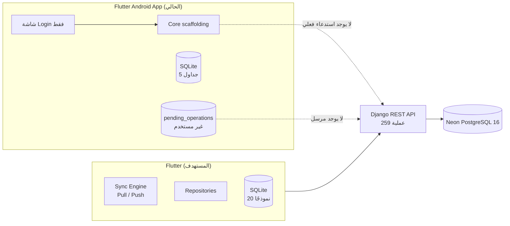
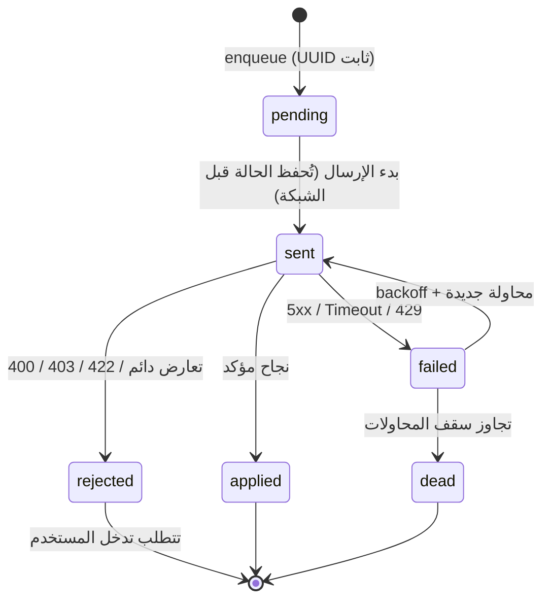
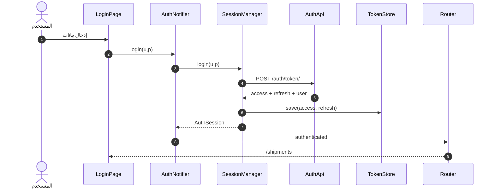

# دراسة عميقة — GoodsTransportationSystemApp

> دراسة معمارية وتقنية شاملة: الكود الحالي، الوثائق، عقد الـAPI الحقيقي، المزامنة، الفجوات، وخطة التنفيذ.

---

## 0. بطاقة الوثيقة

| البند | القيمة |
|---|---|
| الموضوع | تطبيق Flutter Android لنظام نقل البضائع (GTS) |
| النطاق | `lib/` + `app_spec/` + الوثائق الجذرية + الـAPI الإنتاجي (قراءة فقط) |
| تاريخ الدراسة | 2026-10-26 |
| بيئة التحليل | Windows x64، Flutter 3.47.8 (stable)، Dart 3.13.7 |
| منهج التحقق | تحليل ثابت (flutter analyze) + تشغيل أدوات البناء + استدعاءات HTTP حقيقية + مراجعة يدوية لكل ملف |
| حالة الأدلة | أدلة مقاسة (قياسات فعلية) + أدلة موثقة (من `app_spec`) + استنتاجات موسومة |
| القيود | لا توجد بيانات دخول صالحة، لا يوجد كود الخادم على الجهاز، لا يوجد جهاز Android متصل |

**رموز الثقة المستخدمة في الوثيقة:**

| الرمز | المعنى |
|---|---|
| **[م]** | مقاس فعليًا في هذه الدراسة (أمر أو استجابة HTTP) |
| **[و]** | موثق في `app_spec` أو وثائق المشروع، لم يُتحقق منه بشكل مستقل |
| **[س]** | استنتاج تحليلي مبني على الكود/العقد |

---

## 1. الملخص التنفيذي

### 1.1 الحكم النهائي

المشروع الحالي **قالب هيكلي (Template) وليس تطبيقًا قابلاً للتشغيل**. إجمالي ما هو مكتوب: **615 سطرًا في 24 ملف Dart**. لا يوجد مشروع Android، ولا اختبار واحد، ولا محرك مزامنة، ولا حفظ لرموز الدخول. `flutter analyze` يفشل بـ **10 أخطاء و3 تحذيرات**، و`flutter build apk` يفشل لعدم وجود مجلد `android/`.

الأساس المعماري (Feature-First + Domain/Data/Presentation) **صحيح الاتجاه** لكنه **غير مكتمل التنفيذ**: الطبقات موجودة كأسماء ومجلدات، بينما السلوك الفعلي (مصادقة، تخزين، مزامنة) إما غائب أو معطوب.

### 1.2 بطاقة الجاهزية (0–10)

| المحور | الوزن | الدرجة | التبرير المختصر |
|---|---:|---:|---|
| البناء والتشغيل | 20% | 0 | 10 أخطاء تحليل، لا `android/`، لا أصول، لا بناء APK **[م]** |
| المصادقة وإدارة الجلسة | 15% | 2 | تسجيل دخول جزئي، لا حفظ رموز، لا إرسال توكن، لا تجديد سليم |
| المعمارية والطبقات | 15% | 4 | اتجاه الاعتماديات سليم نظريًا، لكن 3 رسوم حقن و4 أصناف مكررة |
| قاعدة البيانات المحلية | 15% | 2 | 5 جداول من 20، JSON blob، لا فهارس، لا ترحيلات |
| المزامنة Offline-First | 20% | 0 | لا Pull، لا Push، لا مؤشر، لا Tombstones، لا معالجة تعارض |
| الاختبارات والجودة | 10% | 0 | صفر اختبارات، لا `analysis_options.yaml`، لا CI، لا Git |
| الأمان | 5% | 4 | `flutter_secure_storage` مستخدم، لكن التوكن لا يُرسل والتدوير مُهمل |
| **الإجمالي المرجّح** | **100%** | **≈ 1.4 / 10 (14%)** | جاهزية نموذج أولي: منخفضة جدًا |

### 1.3 أهم عشر نتائج

1. **المشروع لا يُبنى حاليًا.** المسار `lib/app/router/app_router.dart:3` يشير إلى `../features/...` بدل `../../features/...`، و`user_model.g.dart` غير مولّد، و`auth_service.dart` يستورد مسارات غير موجودة. **[م]**
2. **رأس المصادقة يُرسل فارغًا دائمًا:** `'Authorization' = 'Bearer '` بدون التوكن في ثلاثة مواضع. أي طلب محمي سيرجع 401 حتمًا. **[م]**
3. **تسجيل الدخول لا يحفظ الرموز إطلاقًا.** `AuthRepositoryImpl` يقرأ `user` ويرمي `access` و`refresh`. لا يوجد أي استدعاء لـ`TokenManager.saveTokens` خارج مسار التجديد. **[م]**
4. **لا يوجد محرك مزامنة.** الموجود: جدول طابور + دالة إدخال. المفقود: Pull، Push، Cursor، Tombstones، دمج، تعارض، إعادة محاولة، مراقبة اتصال. **[م]**
5. **تدوير الرموز مُهمل.** الخادم يدوّر `access` و`refresh` معًا **[و]**، بينما العميل يحفظ التوكن الجديد مع **الـrefresh القديم** → تنكسر الجلسة عند أول تجديد. **[م/و]**
6. **قاعدة البيانات غير صالحة لمنتج حقيقي:** 5 جداول فقط من 20 نموذجًا، كل الصفوف أعمدة JSON نصية، بلا فهارس ولا `onUpgrade` ولا معاملات. **[م]**
7. **طابور العمليات معطوب منطقيًا:** `retry_count` يُكتب كنص `'retry_count + 1'`، والحالة `failed` تُعاد للمحاولة فورًا بلا Backoff أو سقف، ولا حالة `sent` ولا `rejected`. **[م]**
8. **ثلاث رسوم حقن اعتماديات متوازية** (`core/providers.dart`، `auth_provider.dart`، `sync_queue.dart`) و**أربعة أصناف شبكة/مصادقة متداخلة** (`ApiClient`, `DioClient`, `AuthService`, `AuthRemoteDataSource`). **[م]**
9. **صفر اختبارات، صفر تكامل مستمر، لا مستودع Git، ولا `analysis_options.yaml`** رغم إعلان `flutter_lints` — أي أن “13 مشكلة” هو حد أدنى وليس الحقيقة الكاملة. **[م]**
10. **تعارض في العقد الموثّق لشكل استجابة السحب:** `API_Reference` يقول `data.changes`، و`SYNCABLE_MODELS` يقول `rows`. يجب حسمه باستدعاء موثّق قبل كتابة المحرك. **[م/و]**

### 1.4 الخلاصة العملية

لا تُبنَ شاشات جديدة فوق هذا الأساس. الترتيب الصحيح:

> **إصلاح البناء → توحيد الشبكة والمصادقة → تأسيس قاعدة البيانات والطابور → محرك المزامنة → أول وحدة أعمال (Shipments) → التوسع.**

---

## 2. المنهجية والأدلة

### 2.1 المصادر

| المصدر | ما استُخدم منه |
|---|---|
| `lib/**` (24 ملفًا) | مراجعة سطر بسطر لكل ملف |
| `app_spec/architecture/*.md` | البنية المستهدفة، قواعد Clean Architecture، متطلبات الأمان |
| `app_spec/api/API_Reference.txt` | 259 عملية، المغلفات، الاستثناءات، الحدود، ملاحظات القياس |
| `app_spec/sync/SYNCABLE_MODELS_Reference.md` | النماذج العشرون وحقولها وبروتوكول المزامنة |
| `MASTER_INSTRUCTIONS.md` + `README.md` | النطاق والأوامر والتعارضات |
| الخادم الإنتاجي | `GET /schema/openapi.json`, `POST /auth/token/`, `GET /sync/`, `GET /capabilities/`, `GET /auth/me` |
| أدوات Flutter | `flutter analyze`, `flutter test`, `flutter build apk --debug`, `flutter --version` |

### 2.2 الأوامر المنفذة ونتائجها

| الأمر | النتيجة **[م]** |
|---|---|
| `flutter --version` | Flutter 3.47.8 / Dart 3.13.7 |
| `flutter analyze` | **13 مشكلة: 10 أخطاء + 3 تحذيرات** (56.5 ثانية) |
| `flutter test` | `Test directory "test" does not appear to contain any test files` |
| `flutter build apk --debug` | فشل: `android/app/build.gradle` غير موجود |
| `GET /api/v1/schema/openapi.json` | 200، 232,618 بايت، OpenAPI 3.0.3 |
| تحليل OpenAPI | **251 مسارًا فريدًا، 259 عملية**، 251 محمية، 8 عامة |
| `GET /api/v1/sync/` بدون توكن | 401 + مغلف خطأ عربي |
| `GET /api/v1/capabilities/` بدون توكن | 401 (يتطلب مصادقة) |
| `GET /api/v1/auth/me` بدون توكن | 401 |
| `GET /api/v1/auth/me/` (بشرطة نهائية) | **404** — المسار الصحيح بلا شرطة |
| `POST /api/v1/auth/token/` ببيانات خاطئة | 401 + رسالة إنجليزية داخل المغلف |
| أول استدعاء بعد سكون (Cold Start) | انتهت المهلة عند 100 ثانية، ثم نجحت الاستدعاءات التالية |

### 2.3 ما لم يُختبر (وعليه تبقى أسئلة مفتوحة)

- **لم يُنفَّذ أي استدعاء موثّق** (لا توجد بيانات دخول) → شكل `data.changes` وحقول `capabilities` وتفاصيل `/auth/me` والصلاحيات لم تُتحقق تجريبيًا.
- **لم يُشغَّل التطبيق على جهاز/محاكي** → لا قياسات أداء أو سلوك واجهة فعلي.
- **كود الخادم غير موجود على الجهاز** (`D:\Project Django Frameworks\GoodsTransportationSystem` غير موجود) → لا مراجعة لصلاحيات الصفوف أو منطق `shipment.advance`.
- **لا قياس حجم بيانات فعلي** → قرارات الأداء مبنية على افتراضات موثقة.

---

## 3. خريطة النظام

### 3.1 السياق العام



### 3.2 الحالة الفعلية للطبقات

| الطبقة | المستهدف **[و]** | الموجود فعليًا **[م]** | الفجوة |
|---|---|---|---|
| Presentation | صفحات + Providers + Widgets | Login + Splash غير موصولة | لا Router guard، لا شاشات أعمال |
| Domain | Entities + Repos + UseCases | `User` + `AuthRepository` + `LoginUseCase` | نحيف، بلا قواعد عمل، `Failure` غير مستخدم |
| Data | Remote + Local + Models + Repos | Remote auth فقط | لا Local DataSource، لا مزامنة، لا Mappers |
| Core | شبكة، DB، Sync، أخطاء | Dio/ApiClient/TokenManager/DB/Queue | مكرر، ناقص، معطوب |
| Sync | Pull/Push/Conflict | لا شيء | 0% |
| Tests | Domain/Data/Presentation | لا شيء | 0% |

---

## 4. تحليل الوثائق (`app_spec`)

### 4.1 جرد الوثائق

| الملف | الحجم | الدور | التقييم |
|---|---:|---|---|
| `architecture/Flutter_Architecture.md` | 27.6 KB | البنية المستهدفة وتدفق البيانات | جيد جدًا كإطار، عام في التفاصيل |
| `architecture/Senior_Flutter_Engineer.md` | 26.1 KB | قواعد Clean Architecture والجودة | ممتاز، لكنه يتعارض مع `pubspec` |
| `architecture/Django_Render_Neon_Flutter.md` | 23.2 KB | التكامل مع الخادم | جيد، يعيد نفس المعلومات |
| `api/API_Reference.txt` | 66.3 KB | عقد الـAPI المقاس | **الأثمن في المشروع** |
| `api/API-ALL.txt` | 2.5 KB | قائمة مختصرة | ناقص (لا يغطي Transport) |
| `sync/SYNCABLE_MODELS_Reference.md` | 6.6 KB | حقول المزامنة | ضروري، لكنه يتعارض في شكل السحب |
| `README.md` (الجذر) | 0.5 KB | تشغيل | قديم: “No packages installed” |

### 4.2 التعارضات والقرارات المطلوبة

| # | التعارض | الطرف الأول | الطرف الثاني | القرار المقترح |
|---:|---|---|---|---|
| 1 | توليد الكود | `Senior_Flutter_Engineer.md`: “لا Freezed/build_runner إلا إذا طُلب صراحة” | `pubspec.yaml` يضم Freezed/json/riverpod_gen، و`MASTER_INSTRUCTIONS` يأمر بـ`build_runner` | اعتماد Codegen رسميًا وتحديث الوثيقة؛ أو حذف الحزم نهائيًا. لا يجوز البقاء بينهما |
| 2 | شكل استجابة السحب | `API_Reference`: `data.changes` | `SYNCABLE_MODELS`: `{rows: ...}` | محاولة قراءة موثقة؛ وبناء Parser متسامح يقرأ `changes` أو `rows` مؤقتًا |
| 3 | محرك قاعدة البيانات | `Flutter_Architecture`: “قيّم Drift” | الكود يستخدم `sqflite` | لـMVP: `sqflite` + مخطط هجين (انظر §8.2 و§7.10)، مع إبقاء Drift خيارًا لاحقًا |
| 4 | مكان `baseUrl` | `core/providers.dart` ثابت | `ApiConstants.baseUrl` ثابت آخر + نص في `auth_provider.dart` | مصدر واحد + `--dart-define` لكل بيئة |
| 5 | عدد المسارات | الوثيقة: 259 Endpoint | OpenAPI: 251 مسارًا / 259 عملية | لا تعارض: 259 عملية موزعة على 251 مسارًا |
| 6 | وعد “Offline-First” | الوثائق تتحدث عن عمل بلا اتصال broadly | Push يدعم 3 عمليات فقط: `shipment.advance`, `shipment.create`, `trip.advance` | **قصر الكتابة offline على هذه العمليات**؛ بقية الوحدات Online-only |
| 7 | هوية المشروع | الاسم `flutter_clean_template` | الاسم التجاري GTS | إعادة تسمية الحزمة قبل بناء Android (تؤثر على `package:` والاستيرادات) |
| 8 | اللغة | جمهور عربي | UI إنجليزي بالكامل | اعتماد `flutter_localizations` + خط عربي + RTL قبل أي شاشة إضافية |

### 4.3 نقاط قوة الوثائق

- عقد API **مقاس** وليس نظريًا، مع استثناءات المغلف موثقة بدقة.
- حدود المعدل وCold Start مذكورة صراحة.
- فصل واضح بين المصادقة والمزامنة والوحدات.
- تحذير صريح من افتراض أسماء الحقول قبل مطابقة العقد.

### 4.4 ثغرات الوثائق

- لا توجد **أمثلة Payload كاملة** لأي عملية Push (الحقول المطلوبة/الاختيارية لكل `kind`).
- لا توجد **سياسة تعارض** محددة (من يفوز؟ هل يوجد `version`/`etag`؟).
- لا يوجد **مخطط صلاحيات** يوضح ما يراه كل دور (Row Scoping مذكور كـ“تمت معالجته” فقط).
- لا يوجد **عقد صفحة `capabilities`** (الحقول المتوقعة).
- لا يوجد **تسلسل زمني للمزامنة** عند انتهاء التوكن أو 429 أو 5xx أثناء الدفع.

---

## 5. تحليل الكود الحالي

### 5.1 الجرد العام

| المؤشر | القيمة **[م]** |
|---|---:|
| ملفات Dart | 24 |
| إجمالي الأسطر | 615 |
| ملفات > 70 سطرًا (المعيار المعلن) | 3 (`database_helper` 96، `api_client` 70، `sync_queue` 60) |
| ملفات اختبار | 0 |
| ملفات مولدة (`.g.dart`) | 0 |
| ملفات ميتة/غير موصولة | 4 (`auth_service`, `splash_screen`, `use_case`, `failures`) |
| رسوم حقن اعتماديات | 3 |
| عملاء HTTP | 2 |
| مسارات `baseUrl` مكررة | 3 |

### 5.2 أدلة البناء (مقاسة)

```
$ flutter analyze
error   app_router.dart:3        Target of URI doesn't exist: '../features/...'
error   app_router.dart:10       The name 'LoginPage' isn't a class
warning app.dart:2               Unused import: go_router
warning token_manager.dart:1     Unused import: dio
error   auth_service.dart:3-4    Target of URI doesn't exist (×2)
error   auth_service.dart:8      Undefined class 'TokenManager'
error   auth_service.dart:14,25  Undefined name 'ApiConstants' (×2)
error   user_model.dart:3        Target of URI hasn't been generated: user_model.g.dart
error   user_model.dart:12-13    '_$UserModelFromJson/ToJson' isn't defined (×2)
warning pubspec.yaml:40          The asset directory 'assets/' doesn't exist
→ 13 issues (10 errors, 3 warnings)
```

```
$ flutter test
Test directory "test" does not appear to contain any test files.

$ flutter build apk --debug
Flutter failed to read file at "...\android\app\build.gradle"
```

**ملاحظة مهمة:** غياب `analysis_options.yaml` يعني أن `flutter_lints` **غير مفعّل**، وأن 13 مشكلة هي حد أدنى. عند تفعيله ستظهر مشاكل إضافية (تسمية، `const`، `use_build_context_synchronously`، إلخ).

### 5.3 عيوب P0 — تمنع التشغيل أو تُفشل الوظيفة الأساسية

#### P0-1 — مسار استيراد خاطئ في الراوتر

`lib/app/router/app_router.dart:3`

```dart
// الحالي (يشير إلى lib/app/features/... غير الموجود)
import '../features/auth/presentation/pages/login_page.dart';

// الصحيح
import '../../features/auth/presentation/pages/login_page.dart';
```

**الأثر:** فشل ترجمة كامل. لا يعمل التطبيق أصلًا.

#### P0-2 — رمز المولّد الناقص

`lib/features/auth/data/models/user_model.dart:3`

```dart
part 'user_model.g.dart'; // غير موجود
```

**الأثر:** خطأ ترجمة. الحل: `dart run build_runner build --delete-conflicting-outputs` أو كتابة `fromJson/toJson` يدويًا (وهو الأنسب لحجم النموذج).

#### P0-3 — ملف ميت بمسارات مستوردة خاطئة

`lib/features/auth/data/datasources/auth_service.dart:3-4`

```dart
import '../auth/token_manager.dart';       // → lib/features/auth/data/auth/... ❌
import '../constants/api_constants.dart';  // → lib/features/auth/data/constants/... ❌
```

**الأثر:** خطأ ترجمة + تكرار وظيفي كامل مع `AuthRemoteDataSource` و`ApiClient`.
**القرار:** حذف `auth_service.dart` نهائيًا (لا مستخدم له).

#### P0-4 — التوكن لا يُرسل أبدًا

`lib/core/api/api_client.dart:20,45,64`

```dart
if (token != null && token.isNotEmpty) {
  options.headers['Authorization'] = 'Bearer ';   // ❌ لا يوجد $token
}
...
error.requestOptions.headers['Authorization'] = 'Bearer '; // ❌
...
void setToken(String token) {
  dio.options.headers['Authorization'] = 'Bearer '; // ❌
}
```

**الأثر:** كل طلب محمي → 401. حتى لو حُفظ التوكن، لن يصل.
**الإصلاح:** `'Bearer $token'` مع اختبار وحدة يتحقق من الرأس.

#### P0-5 — الرموز تُهمل بعد تسجيل الدخول

`lib/features/auth/data/repositories/auth_repository_impl.dart:11-17`

```dart
final data = await remote.login(username, password);
final payload = (data['data'] ?? data) as Map<String, dynamic>;
final userJson = payload['user'] as Map<String, dynamic>;
final model = UserModel.fromJson(userJson);
return User(id: model.id, username: model.username); // ❌ access/refresh مُهملان
```

**الأثر:** المستخدم “يسجل دخول” ثم يبقى بلا جلسة. `logout()` فارغ أيضًا (سطر 20).
**الإصلاح:** إرجاع `AuthSession(access, refresh, user)` من الـRepository، وحفظهما في `TokenManager` داخل UseCase/Repository، وتنظيفهما عند الخروج.

#### P0-6 — لا حفظ للتوكن بعد الدخول + لا توجيه

- `AuthNotifier.login` يحدّث الحالة فقط (`auth_provider.dart:23-31`).
- `app_router.dart` لا يراقب الحالة ولا يوجد `redirect`.
- لا استرجاع جلسة عند بدء التشغيل (`/auth/me` لا يُستدعى أبدًا).

**الأثر:** حتى بعد نجاح الدخول، تبقى الشاشة كما هي، وأي إعادة تشغيل تفقد الجلسة.
**الإصلاح:** `refreshListenable`/`redirect` يعتمد على `AuthState`، وشاشة Splash تستدعي `restoreSession()`.

#### P0-7 — تدوير الـRefresh مُهمل

`lib/core/api/api_client.dart:43`

```dart
await tokenManager.saveTokens(newAccessToken, refreshToken); // refresh القديم
```

الوثيقة تنص: “refresh rotates both tokens — store the new refresh or treat failure as logout” **[و]**.
**الأثر:** أول تجديد ينجح، ثم يفشل الثاني. **الإصلاح:** قراءة `data.refresh` وحفظه، مع قفل Single-Flight.

#### P0-8 — إعادة المحاولة تفقد إعدادات الطلب وقد تدخل حلقة

`lib/core/api/api_client.dart:46-51`

```dart
final opts = Options(method: error.requestOptions.method,
                     headers: error.requestOptions.headers);
final cloneReq = await dio.request(error.requestOptions.path, ...);
```

**الأثر:** فقدان `responseType` و`contentType` و`validateStatus` و`cancelToken` و`extra`؛ وإذا رجع الطلب المجدد 401 مرة أخرى، تعاد الدورة بلا حد.
**الإصلاح:** `dio.fetch(error.requestOptions)` بعد تحديث الرأس، مع `_retry` flag في `extra` وسقف محاولة واحدة.

#### P0-9 — خطأ كتابة `retry_count`

`lib/core/sync/sync_queue.dart:50`

```dart
if (status == 'failed') 'retry_count': 'retry_count + 1',
```

**الأثر:** يُخزَّن النص الحرفي `"retry_count + 1"` في عمود INTEGER (SQLite يسمح بذلك)، فيصبح العدّاد غير رقمي وتفشل أي مقارنة/سقف محاولات.
**الإصلاح:** `'retry_count': (current + 1)` داخل معاملة، أو `retry_count = retry_count + 1` عبر `rawUpdate`.

### 5.4 عيوب P1 — معمارية وتكرار

| # | المشكلة | الدليل | الأثر |
|---:|---|---|---|
| 1 | ثلاث رسوم حقن متوازية | `core/providers.dart:7-12`، `auth_provider.dart:10-13`، `sync_queue.dart:58-60` | نسخ متعددة من Dio/DB، استحالة التحكم في الجلسة |
| 2 | عميلا HTTP | `ApiClient` (30s + interceptors) و`DioClient` (15s بلا interceptors) | سلوك شبكة غير متسق؛ Login لا يمر بالـInterceptor |
| 3 | تكرار طبقة المصادقة | `AuthService` + `AuthRemoteDataSource` + `AuthRepositoryImpl` + `AuthNotifier` | مسؤوليات متداخلة، ثلاثة أشكال لاستدعاء واحد |
| 4 | `Failure` غير مستخدم | `failures.dart` كامل بلا أي مرجع | الأخطاء تصل للواجهة كـ`DioException` خام |
| 5 | `UseCase` غير مستخدم | `use_case.dart` غير موروث | `LoginUseCase` لا يتبع العقد المعلن |
| 6 | `baseUrl` مكرر | 3 مواضع | خطر توجيه بيئة خاطئ |
| 7 | `ApiConstants` بلا `/api/v1` | `api_constants.dart:3-27` | إن رُبط بـ`baseUrl` الصحيح ستكون المسارات ناقصة |
| 8 | `splash_screen` غير موصول | لا مسار ولا مرجع | شاشة ميتة، ولا Bootstrapping فعلي |
| 9 | `bootstrap()` فارغ | `bootstrap.dart:3-6` | لا تهيئة DB/تخزين/اتصال قبل `runApp` |
| 10 | `SyncQueue` بلا مستهلك | `syncQueueProvider` بلا مرجع | الطابور معزول عن التطبيق |

### 5.5 عيوب P2 — جودة وتجربة

| # | المشكلة | الموقع | ملاحظة |
|---:|---|---|---|
| 1 | لا تحقق من المدخلات | `login_page.dart:29-34` | يمكن إرسال فراغات |
| 2 | عرض الخطأ خام | `login_page.dart:35` | `'${state.error}'` يكشف تفاصيل Dio |
| 3 | لا إخفاء/إظهار كلمة المرور | `login_page.dart:27` | تحسين أساسي |
| 4 | لا إغلاق لوحة المفاتيح | `login_page.dart` | تجربة ضعيفة |
| 5 | لا `TextInputAction`/Focus | `login_page.dart` | تنقل يدوي |
| 6 | `StateNotifier` قديم | `auth_provider.dart:15` | الأفضل `Notifier`/`AsyncNotifier` |
| 7 | لا `autoDispose` | كل الـProviders | تسريب حالة |
| 8 | لا `const` في مواضع | متعدد | تحسين أداء |
| 9 | `Future.delayed` داخل `build` | `splash_screen.dart:10` | يتكرر مع كل إعادة بناء |
| 10 | لا دعم RTL/عربي | `app.dart` | لا `localizationsDelegates` |
| 11 | لا خط عربي | `app_theme.dart` | الافتراضي لا يناسب العربية |
| 12 | عنوان “Flutter Clean Template” | `app.dart:13` | هوية خاطئة |
| 13 | اسم الحزمة قالب | `pubspec.yaml:1` | يؤثر على كل الاستيرادات |
| 14 | `assets/` غير موجود | `pubspec.yaml:40` | تحذير بناء |
| 15 | `intl`/`shared_preferences`/`path_provider`/`connectivity_plus` غير مستخدمة | `pubspec.yaml` | تضخم بلا فائدة |

### 5.6 مطابقة Clean Architecture (تقييم)

| المعيار | النتيجة | ملاحظة |
|---|---|---|
| اتجاه الاعتماديات | ✅ جزئيًا | Domain لا يستورد Flutter/Dio (جيد) |
| استقلال Domain | ⚠️ | نحيف جدًا؛ لا قواعد عمل |
| Repository Contracts | ✅ | موجودة لـAuth |
| فصل DTO/Entity | ✅ | موجود شكليًا |
| Use Cases | ⚠️ | موجودة لكن لا تتبع العقد ولا تُختبر |
| معالجة الأخطاء | ❌ | `Failure` معطّل فعليًا |
| حقن الاعتماديات | ❌ | ثلاث حزم متوازية |
| قابلية الاختبار | ❌ | `TokenManager`/`DatabaseHelper` ثابتة/مفردة |
| عدم وجود تجريدات زائدة | ⚠️ | `UseCase`+`Failure`+`AuthService` زائدة بلا استخدام |

### 5.7 خريطة التكرار والكود الميت

```text
المسار الفعلي للشبكة اليوم:

LoginPage → authStateProvider → LoginUseCase → AuthRepositoryImpl
        → AuthRemoteDataSourceImpl → DioClient.dio
        → ('/api/v1/auth/token/')  ✅ يعمل نظريًا

مسار الشبكة الآخر (غير موصول):
core/providers.dart → ApiClient (يكتب Bearer فارغًا) → dioProvider ← لا مستهلك

مسار ثالث:
syncQueueProvider → DatabaseHelper.instance ← لا مستهلك

كود ميت مؤكد:
- auth_service.dart (كلاس + استيرادات خاطئة)
- splash_screen.dart
- use_case.dart
- failures.dart
```

### 5.8 قاعدة البيانات المحلية

**المخطط الحالي:** `database_helper.dart`

```sql
sync_state(id, last_cursor, last_sync_at, last_sync_status)     -- صف واحد
pending_operations(operation_id PK, kind, payload, created_at,
                   status, retry_count, last_error, updated_at)
customers/drivers/vehicles/shipments/trips(id PK, data TEXT, updated_at, ...)
```

**المشاكل:**

| # | المشكلة | الأثر |
|---:|---|---|
| 1 | 5 جداول من 20 نموذجًا | 15 نموذجًا لا يمكن تخزينه |
| 2 | `data TEXT` (JSON) لكل الصفوف | لا فرز/فلترة/بحث فعّال؛ كل شاشة ستفك JSON |
| 3 | لا فهارس | بطء مع آلاف الشحنات |
| 4 | لا `onUpgrade`/`onDowngrade` | أي تغيير مخطط = فقدان بيانات |
| 5 | لا مفاتيح أجنبية | تكامل مرجعي ضعيف |
| 6 | لا جدول Tombstones محلي | لا يمكن حذف ما حُذف على الخادم |
| 7 | لا `dirty`/`local_updated_at` | لا حل تعارض ولا تمييز المحلي عن السحابي |
| 8 | لا قفل/معاملة حول (كتابة محلية + إدخال طابور) | انقطاع التطبيق = بيانات بلا عملية أو العكس |
| 9 | `sync_state` بلا `device_id`/`schema_version` | تشخيص المزامنة مستحيل |
| 10 | `DateTime.now().toIso8601String()` محلي | مقارنة مع توقيت الخادم (UTC) قد تنحرف |

### 5.9 مراجعة الأمان

| الضابط | الحالة | ملاحظة |
|---|---|---|
| تخزين آمن للرموز | ✅ | `flutter_secure_storage` |
| إرسال التوكن | ❌ | `Bearer` فارغ |
| تدوير Refresh | ❌ | يحفظ القديم |
| Single-Flight Refresh | ❌ | طلبات متزامنة قد تجدد عدة مرات |
| الخروج عند فشل التجديد | ⚠️ | يمسح التخزين فقط، لا يوجّه المستخدم |
| عدم تسجيل الأسرار | ✅ | لا Logging للرموز حاليًا |
| HTTPS | ✅ | Base URL بـHTTPS |
| التحقق من الشهادة | ✅ افتراضي | لا تعطيل |
| تشفير SQLite | ❌ | بيانات مالية/تشغيلية بلا تشفير |
| تقييد المحاولات محليًا | ❌ | لا قفل بعد محاولات دخول فاشلة |
| صلاحيات على العميل | ❌ | لا إخفاء وحدات حسب الدور |

### 5.10 تجربة المستخدم والواجهة

- شاشة Login فقط، بلا شعار ولا هوية بصرية ولا دعم عربي.
- لا حالات Empty/Loading/Error منظمة (Loading دائري فقط).
- لا تصميم متجاوب ولا SafeArea صريح.
- لا استخدام لأيقونات/وحدات النظام المرجعي (Django web) كما تشترط الوثائق.
- Splash غير موصولة، ولا شاشة بداية حقيقية.
- لا Bottom Navigation ولا Shell للوحدات.

### 5.11 الاختبارات

| النوع | المطلوب **[و]** | الموجود | الفجوة |
|---|---|---:|---|
| Domain | UseCases + قواعد | 0 | كلها |
| Data | JSON/Mappers/Repos | 0 | كلها |
| Presentation | حالات + تفاعلات | 0 | كلها |
| Integration | تدفق حرج | 0 | كلها |
| Sync | Pull/Push/تعارض | 0 | كلها |

**أدوات جاهزة غير مستخدمة:** `mocktail`، `flutter_test`.

### 5.12 جدول الملفات (24 ملفًا)

| الملف | الأسطر | الدور | الحالة |
|---|---:|---|---|
| `lib/main.dart` | 11 | نقطة الدخول | ✅ |
| `lib/bootstrap.dart` | 6 | تهيئة | ❌ فارغ |
| `lib/app/app.dart` | 20 | MaterialApp | ⚠️ عنوان/استيراد زائد |
| `lib/app/router/app_router.dart` | 13 | التوجيه | ❌ خطأ استيراد |
| `lib/app/theme/app_theme.dart` | 13 | الثيم | ⚠️ بلا عربي |
| `lib/core/providers.dart` | 12 | DI | ⚠️ مكرر |
| `lib/core/api/api_client.dart` | 70 | HTTP + Refresh | ❌ Bearer فارغ |
| `lib/core/network/dio_client.dart` | 21 | HTTP بديل | ⚠️ مكرر |
| `lib/core/auth/token_manager.dart` | 26 | تخزين الرموز | ⚠️ بلا عقد/اختبار |
| `lib/core/constants/api_constants.dart` | 27 | ثوابت | ⚠️ بلا `/api/v1` |
| `lib/core/database/database_helper.dart` | 96 | SQLite | ❌ ناقص |
| `lib/core/sync/sync_queue.dart` | 60 | الطابور | ❌ خطأ + حالات ناقصة |
| `lib/core/error/failures.dart` | 20 | أخطاء | ❌ ميت |
| `lib/core/usecase/use_case.dart` | 5 | عقد UseCase | ❌ ميت |
| `lib/features/auth/domain/entities/user.dart` | 5 | كيان | ✅ |
| `lib/features/auth/domain/repositories/auth_repository.dart` | 6 | عقد | ✅ |
| `lib/features/auth/domain/usecases/login.dart` | 9 | UseCase | ⚠️ لا يتبع العقد |
| `lib/features/auth/data/models/user_model.dart` | 14 | DTO | ❌ بلا مولّد |
| `lib/features/auth/data/datasources/auth_remote_datasource.dart` | 19 | Remote | ✅ |
| `lib/features/auth/data/datasources/auth_service.dart` | 32 | Remote مكرر | ❌ ميت |
| `lib/features/auth/data/repositories/auth_repository_impl.dart` | 21 | Repository | ❌ يهمل الرموز |
| `lib/features/auth/presentation/providers/auth_provider.dart` | 34 | حالة | ⚠️ |
| `lib/features/auth/presentation/pages/login_page.dart` | 41 | شاشة | ⚠️ |
| `lib/features/auth/presentation/pages/splash_screen.dart` | 34 | شاشة | ❌ غير موصولة |
| **الإجمالي** | **615** | | |

---

## 6. تحليل الـAPI الحقيقي (قياسات)

### 6.1 الأرقام الكلية **[م]**

| المؤشر | القيمة |
|---|---:|
| مسارات فريدة | 251 |
| عمليات (Method + Path) | 259 |
| عمليات محمية (`bearerAuth` + `sessionAuth`) | 251 |
| عمليات عامة | 8 |
| حجم مواصفة OpenAPI | 232,618 بايت |
| الإصدار | OpenAPI 3.0.3 |

**العمليات العامة الثماني فقط:** `auth/login`، `auth/status`، `auth/token/`، `auth/token/refresh/`، `docs/`، `redoc/`، `schema/`، `schema/openapi.json`.

> استنتاج مباشر: **كل شيء آخر يتطلب JWT**. لذلك عيب “Bearer فارغ” ليس تفصيلًا، بل يمنع 251 عملية من أصل 259.

### 6.2 توزيع العمليات حسب الوحدة **[م]**

| الوحدة | العمليات |
|---|---:|
| transport | 77 |
| org | 30 |
| journal_entries | 27 |
| accounting_reviewer | 23 |
| financial_analysis | 13 |
| chart_of_accounts | 12 |
| users | 11 |
| accounting_reports | 11 |
| budgets | 9 |
| settings | 9 |
| regions | 8 |
| auth | 6 |
| backup | 5 |
| example | 5 |
| reports_center | 4 |
| schema | 2 |
| sync | 2 |
| audit-logs / dashboard / docs / redoc / capabilities | 1 لكلٍّ |

### 6.3 قواعد المغلف (كما قيست ووُثقت)

| الحالة | الشكل |
|---|---|
| نجاح قياسي | `{"success":true,"message":"...","data":...,"errors":null}` |
| خطأ | `{"success":false,"error":"...","message":"..."}` — لاحظ **`error` مفرد** |
| قائمة مُصفّحة | `data = {"items":[...], "meta":{...}}` |
| إنشاء/تعديل | `{"success":true,"message":"...","<entity>":{...}}` — الكيان في الأعلى لا داخل `data` |
| استثناءات | `/users`, `/backup/list` → مصفوفة خام؛ `/settings/*` → مفاتيح محددة؛ `/dashboard/stats` → كائن مسطح |

**دليل حي [م]:**

```http
POST /api/v1/auth/token/  {"username":"__probe__","password":"__probe__"}
401
{"success":false,"message":"No active account found with the given credentials",
 "error":"No active account found with the given credentials","data":null,"errors":null}
```

**الاستنتاج:** رسالة الخطأ قد تكون **إنجليزية** رغم أن رسائل 401 الأخرى عربية → لا تعتمد على لغة الرسالة، اعتمد على `statusCode` و`error`.

### 6.4 تفاصيل حساسة للمسارات **[م]**

| المسار | النتيجة | الأثر على التطبيق |
|---|---|---|
| `/api/v1/auth/me` | 401 (موجود) | استخدمه بلا شرطة نهائية |
| `/api/v1/auth/me/` | **404** | شرطة زائدة تكسر الطلب |
| `/api/v1/sync/` | 401 (موجود) | يتطلب شرطة نهائية |
| `/api/v1/capabilities/` | 401 | لا يمكن اكتشاف النماذج قبل الدخول |
| `/api/v1/schema/openapi.json` | 200 | مصدر الحقيقة للعقد |

### 6.5 حدود المعدل والبنية التحتية **[و]**

| المورد | الحد |
|---|---|
| `auth/token` و`auth/login` | 10 طلبات/دقيقة (مشتركة) |
| `sync` | 300 طلب/دقيقة |
| بقية الـAPI | 60 طلب/دقيقة |
| Cold Start | 30–60 ثانية نظريًا؛ **قياسنا تجاوز 100 ثانية** **[م]** |

**الأثر التصميمي:**

1. `connectTimeout` الحالي 15–30 ثانية **غير كافٍ** لأول طلب بعد سكون. يحتاج 90–120 ثانية + إعادة محاولة واحدة على الأقل.
2. دفع العمليات يجب أن يكون **دُفعات** (مثلًا 25–50 عملية) لتفادي 429.
3. سحب 20 نموذجًا × عدة صفحات لا يجوز أن يتحول إلى 20 طلبًا متوازيًا عند كل مزامنة؛ الأفضل طلب مجمّع مع `models` و`page_size=500`.
4. 429 يحتاج Backoff يحترم `Retry-After` إن وُجد.

### 6.6 جودة OpenAPI

المواصفة تولّدت من الـResolver، وتحتوي **المسارات والأمان** بدقة، لكنها **لا تحتوي Schemas لحقول الطلبات/الاستجابات** (كلها `$ref` إلى `Envelope` عام). أي أن التطبيق لا يستطيع توليد DTOs منها؛ الحقول تأتي من `SYNCABLE_MODELS` + القياس الفعلي.

---

## 7. عقد المزامنة (Offline-First)

### 7.1 البروتوكول كما هو موثّق **[و]**

| البند | القيمة |
|---|---|
| نقطة النهاية | `GET/POST /api/v1/sync/` |
| السحب | `?cursor=<ISO8601>&models=shipment,trip&page=1&page_size=500` |
| الدفع | `{"operations":[{"operation_id":"<uuid>","kind":"...","payload":{...}}]}` |
| المؤشر | `updated_at` بساعة **الخادم** (UTC) |
| حجم الصفحة | 500 صف لكل نموذج |
| منع التكرار | `operation_id` — الإعادة ترجع النتيجة المسجلة |
| الحذف | `SyncTombstone` يُسحب مع التغييرات |
| النماذج | 20 |
| أنواع الدفع | 3 فقط: `shipment.advance`, `shipment.create`, `trip.advance` |

### 7.2 النماذج العشرون **[و]**

| # | المفتاح | نموذج Django | عدد الحقول | ملاحظات |
|---:|---|---|---:|---|
| 1 | `customer` | `transport.customer` | 10 | معرّف نصي مثل `CU-0001` |
| 2 | `driver` | `transport.driver` | 10 | |
| 3 | `vehicle` | `transport.vehicle` | 11 | `capKg`, `vol`, `km` |
| 4 | `goods` | `transport.goodstype` | 7 | المفتاح `goods` ≠ اسم النموذج |
| 5 | `route` | `transport.route` | 6 | |
| 6 | `branch` | `transport.branch` | 8 | |
| 7 | `agent` | `transport.agent` | 8 | |
| 8 | `shipment` | `transport.shipment` | 36 | الأكبر والأهم |
| 9 | `trip` | `transport.trip` | 22 | |
| 10 | `payment` | `transport.payment` | 17 | مالي |
| 11 | `expense` | `transport.expense` | 10 | مالي |
| 12 | `invoice` | `transport.invoice` | 16 | مالي |
| 13 | `company` | `org.company` | 16 | |
| 14 | `city` | `org.city` | 6 | |
| 15 | `location` | `org.location` | 11 | |
| 16 | `operational_entity` | `org.operationalentity` | 10 | |
| 17 | `department` | `org.department` | 11 | |
| 18 | `chart_of_accounts_item` | `chart_of_accounts.chartofaccountsitem` | 11 | معرّف رقمي |
| 19 | `journal_entries_item` | `journal_entries.journalentriesitem` | 16 | `lines` متداخلة |
| 20 | `regions_item` | `regions.regionsitem` | 11 | |
| | **الإجمالي** | | **253 حقلًا** | |

**تنبيه حاسم:** تسمية الحقول **مختلطة** بين `camelCase` و`snake_case` في نفس النموذج (`feeTotal` و`tripId` مع `updated_at`). لا تستخدم تحويلًا تلقائيًا للحالة (case conversion)؛ استخدم أسماء صريحة لكل حقل أو احتفظ بالـPayload كما هو.

### 7.3 تعارض شكل استجابة السحب

| المصدر | الشكل |
|---|---|
| `API_Reference.txt` (مقاس) | `data.changes` + `data.tombstones` + `data.next_cursor` + `data.pagination` |
| `SYNCABLE_MODELS_Reference.md` | `{rows: {model: [...]}, tombstones: [...]}` |

**القرار المؤقت:** Parser متسامح:

```dart
final data = envelope['data'] as Map<String, dynamic>;
final changes = (data['changes'] ?? data['rows']) as Map<String, dynamic>?;
if (changes == null) throw const ParseFailure('Unexpected sync pull shape');
```

ثم **يُحسم نهائيًا** باستدعاء موثّق واحد وتوثيق الناتج في اختبار عقد (Contract Test). لا تبنِ 20 Repository على افتراض غير متحقق.

### 7.4 Pagination — المخاطر الخفية

الاستجابة تحتوي `pagination` **لكل نموذج** (`has_next` مستقل). هذا يعني:

1. لا يجوز الاكتفاء بـ`page=1`.
2. لا يجوز تقديم المؤشر بعد الصفحة الأولى، وإلا فُقدت صفوف.
3. يجب الاستمرار حتى `has_next=false` لكل النماذج المطلوبة.
4. إذا تغيّر الخادم أثناء التصفح، قد تتكرر صفوف — لذلك التطبيق (Upsert) وليس (Insert).
5. `next_cursor` غير موضح هل هو “مؤشر نهاية هذه الصفحة” أم “أقصى updated_at في الاستجابة”. **[س]** يجب اختباره: إن كان الأول، فلا تقدمه إلا بعد آخر صفحة.

**خوارزمية آمنة مقترحة:**

```text
cursor0 = stored_cursor
page = 1
allChanges = {}
allTombstones = []
loop:
  r = GET /sync/?cursor=cursor0&page=page&page_size=500[&models=...]
  merge allChanges, allTombstones
  if no model has has_next: break
  page++
transaction:
  upsert allChanges
  apply allTombstones
  set stored_cursor = max(r.next_cursor, cursor0)
  set last_sync_at = server_time(r)
commit
```

### 7.5 Idempotency

- يُولَّد `operation_id` **مرة واحدة عند الإنشاء المحلي** ويُخزَّن مع العملية.
- عند إعادة الإرسال: **نفس المعرّف**، وإلا تكرر الأثر.
- بعد الاستجابة: خزّن نتيجة الخادم (نجاح/فشل) لتفادي إعادة التنفيذ.
- لا تحذف العمليات الناجحة فورًا؛ احتفظ بها مدة (مثلًا 7 أيام) لأغراض التشخيص ومنع التكرار.

### 7.6 Tombstones

الشكل الموثق:

```json
{"model_label":"transport.Customer","object_pk":"CU-0001"}
```

**المطلوب محليًا:**

1. جدول `model_label → model_key` (مثل `transport.Customer → customer`، `transport.Goodstype → goods`).
2. عدم حذف صف محلي لديه عملية معلّقة؛ بدلًا من ذلك `pending_delete=true` ثم الحذف بعد حسم العملية.
3. تسجيل المؤشر بعد تطبيق الحذف داخل نفس المعاملة.

### 7.7 سياسة التعارض المقترحة

| الحالة | القرار |
|---|---|
| لا تعديل محلي + تحديث خادم | الخادم يفوز (Upsert) |
| تعديل محلي معلّق + لا تحديث خادم | ادفع أولًا ثم اسحب |
| تعديل محلي معلّق + تحديث خادم أحدث | **تعارض**: احتفظ بالنسختين، اعرض للمستخدم، لا تدمج تلقائيًا |
| حذف من الخادم + تعديل محلي معلّق | ادفع؛ إن رفض الخادم → علم الصف “محذوف على الخادم” واطلب قرارًا |
| عمليتان محليتان على نفس السجل | تسلسل حسب `created_at`، ولا تدمج |

> لا يوجد `version`/`etag` في العقد **[و]**، لذلك الحل الواقعي: **الخادم مرجعي + منع الكتابة المتزامنة من نفس السجل + إظهار التعارض**. لا تحاول “Last Write Wins” أعمى.

### 7.8 آلة حالة عملية الطابور



**مقارنة بالحالي:** الموجود `pending/failed` فقط، و`failed` يعاد فورًا، و`applied` لا يُستخدم، و`sent/rejected/dead` غائبة.

### 7.9 حالات حدّية يجب تصميمها صراحة

| # | السيناريو | السلوك المطلوب |
|---:|---|---|
| 1 | انقطاع الشبكة أثناء الدفع | تبقى العمليات `sent`؛ عند العودة تُستعلم/تعاد بنفس `operation_id` |
| 2 | انقطاع أثناء السحب قبل الحفظ | لا يتقدم المؤشر؛ إعادة المحاولة آمنة (Upsert) |
| 3 | 401 أثناء المزامنة | تجديد واحد؛ إن فشل → إيقاف المزامنة وحفظ الطابور وطلب دخول |
| 4 | 429 | احترام `Retry-After` + Backoff أسّي |
| 5 | 5xx متكرر | Backoff حتى سقف، ثم `dead` مع إشعار |
| 6 | عملية مرفوضة 422 | `rejected` + عرض سبب الخادم للمستخدم |
| 7 | صف محلي “متسخ” وحُذف على الخادم | لا تحذف قبل حسم الدفع |
| 8 | تكرار صف في صفحتين | Upsert بمفتاح `(model, id)` |
| 9 | نموذج جديد يضيفه الخادم | اكتشاف عبر `/capabilities/` وتحديث السجل |
| 10 | ساعة الجهاز خاطئة | لا تستخدمها للمؤشر أو التعارض؛ اعرض فقط |
| 11 | إعادة تشغيل التطبيق أثناء `sent` | عند البدء: أعد إرسال `sent` بنفس المعرّف |
| 12 | تغيير مخطط DB مع بيانات | ترحيلات متدرجة + نسخة احتياطية |
| 13 | حجم بيانات كبير | صفحة 500 + فهارس + حذف الصفوف القديمة غير المستخدمة |
| 14 | المستخدم يسجّل الخروج وعمليات معلقة | احتفظ بالطابور أو امسحه بتحذير صريح (قرار منتج) |
| 15 | Cold Start | مهلة طويلة + Retry واحد + مؤشر “جارٍ الاتصال” |

### 7.10 مخطط قاعدة البيانات المقترح (هجين)

**الفكرة:** جدول عام للمزامنة لكل النماذج + جداول/عروض مُسقطة (Projections) للشاشات الساخنة.

```sql
CREATE TABLE sync_state (
  id INTEGER PRIMARY KEY CHECK (id = 1),
  cursor TEXT,
  last_sync_at TEXT,
  last_status TEXT,
  device_id TEXT NOT NULL,
  schema_version INTEGER NOT NULL DEFAULT 1
);

CREATE TABLE sync_records (
  model TEXT NOT NULL,
  id TEXT NOT NULL,
  payload TEXT NOT NULL,              -- الحقول كما وصلت (بلا تحويل)
  server_updated_at TEXT,             -- updated_at من الخادم
  local_updated_at TEXT,              -- آخر تعديل محلي
  base_updated_at TEXT,               -- أساس التعارض
  deleted INTEGER NOT NULL DEFAULT 0,
  pending_delete INTEGER NOT NULL DEFAULT 0,
  dirty INTEGER NOT NULL DEFAULT 0,
  PRIMARY KEY (model, id)
);
CREATE INDEX idx_records_model_updated ON sync_records(model, server_updated_at);
CREATE INDEX idx_records_dirty ON sync_records(dirty) WHERE dirty = 1;

CREATE TABLE pending_operations (
  operation_id TEXT PRIMARY KEY,
  kind TEXT NOT NULL,
  entity_type TEXT,
  entity_id TEXT,
  payload TEXT NOT NULL,
  status TEXT NOT NULL,
  attempts INTEGER NOT NULL DEFAULT 0,
  next_attempt_at TEXT,
  last_error TEXT,
  last_status_code INTEGER,
  created_at TEXT NOT NULL,
  updated_at TEXT NOT NULL
);
CREATE INDEX idx_ops_due ON pending_operations(status, next_attempt_at);

CREATE TABLE sync_tombstones (
  model TEXT NOT NULL,
  object_pk TEXT NOT NULL,
  received_at TEXT NOT NULL,
  applied INTEGER NOT NULL DEFAULT 0,
  PRIMARY KEY (model, object_pk)
);

CREATE TABLE sync_log (
  id INTEGER PRIMARY KEY AUTOINCREMENT,
  started_at TEXT, finished_at TEXT, result TEXT,
  pulled INTEGER, pushed INTEGER, failed INTEGER, error TEXT
);

-- عرض للشاشات الساخنة (مثال)
CREATE VIEW v_shipments AS
SELECT
  id,
  json_extract(payload, '$.waybill')  AS waybill,
  json_extract(payload, '$.status')   AS status,
  json_extract(payload, '$.customer') AS customer,
  json_extract(payload, '$.from')     AS origin,
  json_extract(payload, '$.to')       AS destination,
  json_extract(payload, '$.feeTotal') AS fee_total,
  server_updated_at
FROM sync_records
WHERE model = 'shipment' AND deleted = 0;

CREATE INDEX idx_shipment_status
  ON sync_records(json_extract(payload, '$.status'))
  WHERE model = 'shipment';
```

**لماذا هذا أفضل من الحالي؟**

- يخدم 20 نموذجًا بجدول واحد → محرك مزامنة عام بلا 20 DAO.
- يحافظ على الحقول الخام (لا فقدان حقول مستقبلية).
- يفصل “البيانات” عن “عرض الشاشة”.
- يدعم التعارض والحذف والتشخيص.

**البديل:** Drift مع جداول مولدة. أفضل في الأنواع والاستعلامات، وأسوأ في زمن التأسيس وحجم الـBoilerplate. القرار موثق في §8.2.

### 7.11 مصفوفة أخطاء المزامنة

| الحالة | تصنيف | إعادة محاولة | إجراء إضافي |
|---|---|---|---|
| لا اتصال | عابر | نعم | انتظار Connectivity |
| Timeout / Cold Start | عابر | نعم (مرة فورية + Backoff) | إطالة المهلة |
| 401 | مصادقة | مرة واحدة بعد Refresh | فشل → Logout مع حفظ الطابور |
| 403 | صلاحيات | لا | رسالة واضحة + إخفاء الإجراء |
| 400/422 | تحقق | لا | `rejected` + سبب |
| 409 | تعارض | لا | عرض قرار للمستخدم |
| 429 | حد معدل | نعم | `Retry-After` |
| 5xx | خادم | نعم | Backoff + سقف |
| رد غير متوقع | تحليل | لا | `ParseFailure` + تسجيل حجم/مفتاح الرد |

---

## 8. التصميم المستهدف

### 8.1 قرارات معمارية (ADR مختصرة)

| # | القرار | السبب | البديل المرفوض |
|---:|---|---|---|
| 1 | **Dio واحد** مع Interceptors (Auth, Error, Retry) | سلوك موحد + اختبار أسهل | عميلان (الحالي) |
| 2 | `TokenStore` واجهة + تنفيذ آمن | قابلية الاختبار والتبديل | Static const storage |
| 3 | `Result<T>` صريح عند حدود الطبقات | لا استثناءات تصل للواجهة | Exceptions خام |
| 4 | `sqflite` + مخطط هجين | بلا Codegen، يكفي MVP، مرن | Drift الآن |
| 5 | الخادم مرجعي + تعارض معلن | لا يوجد ETag/Version | LWW أعمى |
| 6 | الكتابة offline لـ3 عمليات فقط | قيد الخادم الحقيقي | وعد offline شامل |
| 7 | مستودع واحد للـSync + مستودعات قراءة للأعمال | فصل واضح للمسؤوليات | Repository لكل نموذج ×20 |
| 8 | تعطيل Freezed/riverpod_gen مؤقتًا | لا استخدام فعلي + تعارض وثائقي | تركهما معلّقتين |
| 9 | إعداد البيئة عبر `--dart-define` | Staging/Production | Base URL ثابت |
| 10 | اختبارات عقد للـAPI | العقد غير مولد الحقول | الاعتماد على الوثائق فقط |

> **ADR-8 يحتاج قرارك:** إن أراد الفريق الالتزام بـCodegen، نقلب القرار ونستخدم Freezed + Drift + riverpod_generator بشكل متسق. المهم ألا يبقى المشروع بين الحالتين.

### 8.2 اختيار قاعدة البيانات — مقارنة تنفيذية

| المعيار | sqflite (هجين) | Drift |
|---|---|---|
| زمن التأسيس | سريع | أعلى (Codegen + إعداد) |
| أمان الأنواع | يدوي | ممتاز |
| الترحيلات | يدوية | مولدة/منظمة |
| الاستعلامات | SQL خام | Type-safe + Reactive |
| 20 نموذجًا | جدول عام + عروض | 20 جدولًا + مولد |
| التوافق مع قواعد المشروع | ✅ لا Codegen | ❌ يتطلب Codegen |
| المخاطرة | متوسطة (SQL يدوي) | منخفضة بعد التأسيس |
| **القرار** | **✅ للـMVP** | لاحقًا عند تعقيد الاستعلامات |

### 8.3 الهيكل المقترح

```text
lib/
├── main.dart
├── bootstrap.dart                    # تهيئة: DB, Tokens, Connectivity, Sync
├── app/
│   ├── app.dart
│   ├── router/
│   │   ├── app_router.dart           # redirect + guards
│   │   └── routes.dart
│   ├── theme/{app_theme,app_colors,app_typography}.dart
│   └── l10n/{app_ar.arb,app_localizations.dart}
├── core/
│   ├── config/app_config.dart        # --dart-define
│   ├── network/
│   │   ├── dio_factory.dart
│   │   ├── auth_interceptor.dart
│   │   ├── error_interceptor.dart
│   │   ├── envelope.dart
│   │   └── api_exception.dart
│   ├── auth/
│   │   ├── token_store.dart          # abstract
│   │   ├── secure_token_store.dart
│   │   └── session_manager.dart      # single-flight refresh
│   ├── error/{result.dart,failures.dart}
│   ├── database/
│   │   ├── app_database.dart
│   │   ├── migrations.dart
│   │   └── dao/{sync_records_dao,sync_state_dao,operations_dao}.dart
│   ├── sync/
│   │   ├── sync_engine.dart
│   │   ├── sync_api.dart
│   │   ├── pull_service.dart
│   │   ├── push_service.dart
│   │   ├── sync_queue.dart
│   │   ├── backoff.dart
│   │   ├── model_registry.dart
│   │   └── tombstone_handler.dart
│   ├── connectivity/connectivity_service.dart
│   └── utils/{clock.dart,json_read.dart,logger.dart}
├── features/
│   ├── auth/{domain,data,presentation}
│   ├── shipments/{domain,data,presentation}
│   ├── trips/{domain,data,presentation}
│   ├── reference_data/{domain,data,presentation}
│   └── dashboard/{domain,data,presentation}
└── shared/widgets/{app_button,empty_state,error_view,loading_view}.dart
```

### 8.4 نموذج الأخطاء

```dart
// core/error/failures.dart
sealed class Failure {
  const Failure(this.message, {this.code, this.retryable = false});
  final String message;
  final String? code;
  final bool retryable;
}

final class NetworkFailure extends Failure { const NetworkFailure(super.m, {super.code, super.retryable = true}); }
final class TimeoutFailure extends Failure { const TimeoutFailure(super.m, {super.code, super.retryable = true}); }
final class ServerFailure extends Failure { const ServerFailure(super.m, {super.code, super.retryable = true, this.statusCode}); final int? statusCode; }
final class AuthFailure extends Failure { const AuthFailure(super.m, {super.code}); }
final class ValidationFailure extends Failure { const ValidationFailure(super.m, {this.fields = const {}}); final Map<String, String> fields; }
final class ConflictFailure extends Failure { const ConflictFailure(super.m, {super.code}); }
final class RateLimitFailure extends Failure { const RateLimitFailure(super.m, {this.retryAfter}); final Duration? retryAfter; }
final class ParseFailure extends Failure { const ParseFailure(super.m, {super.code}); }
final class StorageFailure extends Failure { const StorageFailure(super.m, {super.code}); }

// core/error/result.dart
sealed class Result<T> {
  const Result();
  R fold<R>(R Function(Failure f) onErr, R Function(T v) onOk);
  bool get isOk => this is Ok<T>;
}

final class Ok<T> extends Result<T> {
  const Ok(this.value);
  final T value;
  @override R fold<R>(R Function(Failure) onErr, R Function(T) onOk) => onOk(value);
}

final class Err<T> extends Result<T> {
  const Err(this.failure);
  final Failure failure;
  @override R fold<R>(R Function(Failure) onErr, R Function(T) onOk) => onErr(failure);
}
```

**قاعدة الحدود:** `DioException` يُحوَّل إلى `Failure` **داخل** طبقة الشبكة فقط. لا يعرف Domain ولا Presentation شيئًا عن HTTP.

### 8.5 المصادقة — التصميم الصحيح



**Single-Flight Refresh (إلزامي):**

```dart
class SessionManager {
  Future<String?>? _inflight;

  Future<String?> refreshAccessToken() {
    _inflight ??= _refresh()
        .whenComplete(() => _inflight = null);
    return _inflight!;
  }

  Future<String?> _refresh() async {
    final refresh = await store.readRefresh();
    if (refresh == null) return null;
    final res = await api.refresh(refresh);       // يعيد access + refresh مدوّرين
    await store.save(access: res.access, refresh: res.refresh);
    return res.access;
  }
}
```

**Interceptor صحيح:**

```dart
onRequest: (options, handler) async {
  if (options.extra['skipAuth'] != true) {
    final token = await store.readAccess();
    if (token != null && token.isNotEmpty) {
      options.headers['Authorization'] = 'Bearer $token';
    }
  }
  handler.next(options);
},
onError: (e, handler) async {
  if (e.response?.statusCode != 401) return handler.next(e);
  if (e.requestOptions.extra['retried'] == true) return handler.next(e);

  final newToken = await session.refreshAccessToken();
  if (newToken == null) {
    await session.logout(reason: SessionExpired());
    return handler.next(e);
  }

  final req = e.requestOptions;
  req.headers['Authorization'] = 'Bearer $newToken';
  req.extra['retried'] = true;
  try {
    handler.resolve(await dio.fetch(req));   // يحافظ على كل الإعدادات
  } catch (_) {
    handler.next(e);
  }
},
```

**نقاط إلزامية:**

- لا تُجدد الجلسة في مسار `login` (استخدم `skipAuth`).
- خزّن **الـrefresh المدوّر**.
- عند فشل التجديد: امسح الرموز + أبلغ الراوتر + لا تحذف الطابور.
- استرجاع الجلسة عند الإقلاع عبر `/auth/me` (بلا شرطة نهائية).

### 8.6 محرك المزامنة — المكوّنات

| المكوّن | المسؤولية | لا يفعل |
|---|---|---|
| `SyncEngine` | تنسيق: Push ثم Pull، القفل، الجدولة | لا يعرف الشاشات |
| `PullService` | الصفحات، الدمج، Tombstones، المؤشر | لا يدفع |
| `PushService` | الدفعات، النتائج، الحالات | لا يسحب |
| `SyncQueue` | CRUD العمليات + Due + Backoff | لا يتصل بالشبكة |
| `Backoff` | أسّي + Jitter + سقف | لا يعرف HTTP |
| `ModelRegistry` | `model_key ↔ model_label` + الحقول | لا يخزن |
| `ConnectivityService` | مراقبة الحالة | لا يزامن مباشرة |
| `SyncStateDao` | المؤشر والجهاز والسجل | لا يقرر |

**واجهة مقترحة:**

```dart
abstract interface class SyncEngine {
  Future<SyncReport> syncNow({SyncTrigger trigger});
  Stream<SyncEvent> get events;
  void start();      // يستمع للاتصال + مؤقت دوري
  Future<void> stop();
}

enum SyncTrigger { manual, appStart, connectivity, timer }
```

**قفل التنفيذ:** `Completer`/`Mutex` داخلي يمنع مزامنتين متوازيتين (شائع مع Connectivity + Timer).

### 8.7 الواجهة واللغة

- `flutter_localizations` + `supportedLocales: [ar]` + `Directionality` تلقائي.
- خط عربي (Cairo/Tajawal/IBM Plex Sans Arabic) + أرقام/تواريخ عبر `intl`.
- تصميم RTL أولًا، مع اختبار نصوص طويلة.
- حالات: `Loading`, `Empty`, `Error`, `Offline`, `Syncing`, `Conflict`.
- شريط حالة مزامنة بسيط (آخر مزامنة + عدد العمليات المعلقة).
- لا تعرض أزرارًا لعملية غير مدعومة offline (مثل إنشاء عميل) إلا بحالة “يتطلب اتصالًا”.

### 8.8 الاختبارات المطلوبة (حد أدنى)

| المستوى | الاختبارات |
|---|---|
| Unit | Envelope parser، Failure mapping، Backoff، Queue state machine، Conflict rules، Date/UTC |
| Data | Parsing لعينات من 20 نموذجًا، Tombstone mapping، Upsert idempotent |
| Auth | حفظ الرموز، رأس Bearer، Single-flight refresh، تدوير refresh، Logout عند الفشل |
| Sync | Pull متعدد الصفحات، فشل منتصف السحب، إعادة push بنفس UUID، 429/5xx/401 |
| Widget | Login (4 حالات)، قائمة الشحنات (Loading/Empty/Error/Data) |
| Integration | Fake Dio adapter + SQLite in-memory (`sqflite_common_ffi`) |
| Contract | استدعاء حقيقي (اختياري/ليلي) للتحقق من `changes` و`capabilities` |

---

## 9. خطة التنفيذ

### 9.1 المراحل

| المرحلة | المهام | المخرجات | معيار القبول | التقدير |
|---|---|---|---|---:|
| **0. إصلاح الأساس** | حذف `auth_service`، تصحيح الراوتر، توليد/كتابة JSON، إنشاء `android/`، `analysis_options.yaml`، `git init`، إعادة تسمية الحزمة | بناء يمر | `flutter analyze` = 0 أخطاء، `flutter build apk --debug` ينجح | 0.5–1 يوم |
| **1. الشبكة والمصادقة** | Dio واحد + Interceptors + TokenStore + SessionManager + Envelope + Result + Router guard + شاشة دخول عربية | دخول كامل + استرجاع جلسة | تسجيل دخول حقيقي، إعادة تشغيل تحفظ الجلسة، 401→تجديد→نجاح | 2–3 أيام |
| **2. قاعدة البيانات والطابور** | مخطط هجين + ترحيلات + DAOs + Queue v2 + Backoff + اختبارات | DB + Queue | إدخال/قراءة بعد إعادة التشغيل، حالات الطابور الست تعمل | 2 أيام |
| **3. محرك المزامنة** | Pull/Push + صفحات + Tombstones + قفل + أحداث + Connectivity | Sync Engine | سحب 20 نموذجًا، دفع 3 أنواع، لا فقدان صفوف، لا تكرار أثر | 3–4 أيام |
| **4. الشحنات (Offline)** | قائمة/تفاصيل/إنشاء/advance + طابور + تعارض + اختبارات | وحدة Shipments | إنشاء شحنة بلا إنترنت ثم مزامنتها بنجاح | 4–6 أيام |
| **5. الرحلات** | قائمة/تفاصيل/advance + ربط الشحنات | وحدة Trips | تقدم رحلة ومزامنة | 2–3 أيام |
| **6. البيانات المرجعية + Dashboard** | عملاء/سائقون/مركبات/بضائع/طرق/فروع/وكلاء (قراءة) + إحصاءات | وحدات قراءة | تصفح بلا إنترنت بعد مزامنة أولى | 2 أيام |
| **7. التلميع والإطلاق** | RTL/خط/أيقونات/حالات/أداء/أمان + APK release + CI | نسخة تجريبية | قائمة قبول §12 كاملة | 2 أيام |
| | **الإجمالي** | | | **18–23 يوم عمل** |

### 9.2 نطاق MVP مقابل المؤجل

| داخل MVP | مؤجل |
|---|---|
| Auth + Session | المحاسبة (`chart_of_accounts`, `journal_entries`) |
| Shipments (قراءة/إنشاء/advance) | الميزانيات، التقارير المحاسبية، المراجع |
| Trips (قراءة/advance) | التحليل المالي + المساعد AI |
| مرجعية للقراءة فقط | Vouchers/Ledgers/Invoices/Payments/Expenses (كتابة) |
| Sync Pull/Push + Queue | Backup/Restore، Audit Logs، Settings |
| Dashboard بسيط | Users/Groups/Roles إدارة |
| عربي/RTL + APK | تعدد اللغات، Tablet Layout متقدم |

> **مبرر التأجيل:** Push يدعم 3 عمليات فقط **[و]**؛ أي شاشة كتابة أخرى ستكون Online-only وتحتاج تصميم أخطاء مختلفًا. لا تخلطها بالـMVP.

### 9.3 أول 10 مهام تقنية بالترتيب

1. `git init` + `.gitignore` + `analysis_options.yaml` (include flutter_lints).
2. حذف `auth_service.dart` وإصلاح استيراد الراوتر.
3. إنشاء `android/` عبر `flutter create --platforms=android --org <org> .` ثم ضبط `applicationId` والاسم.
4. إنشاء `assets/` أو حذف سطر الأصول من `pubspec.yaml`.
5. كتابة `AppConfig` بـ`--dart-define` وإزالة الـ3 نسخ من `baseUrl`.
6. بناء `Dio` واحد + `Envelope` + `ApiException`.
7. `TokenStore` + `SessionManager` + إصلاح `Bearer $token` + تدوير refresh.
8. جعل `AuthRepository.login` يعيد `AuthSession` ويحفظ الرموز.
9. Router guard + استرجاع جلسة عبر `/auth/me` + Splash حقيقية.
10. كتابة أول 8 اختبارات (رأس التوكن، التجديد، المغلف، الحفظ، الفشل).

---

## 10. مصفوفة الفجوات

| المتطلب | الحالة الحالية | الهدف | الأولوية |
|---|---|---|---|
| بناء APK | ❌ لا `android/` | مشروع Android كامل | P0 |
| تحليل نظيف | ❌ 10 أخطاء | 0 أخطاء + lints | P0 |
| إرسال JWT | ❌ Bearer فارغ | رأس صحيح + اختبار | P0 |
| حفظ الجلسة | ❌ | Secure Storage + استرجاع | P0 |
| تدوير Refresh | ❌ | حفظ التوكنين + Single-flight | P0 |
| توجيه حسب الحالة | ❌ | Redirect + Splash | P0 |
| قاعدة 20 نموذجًا | ❌ 5 جداول | جدول عام + عروض | P1 |
| ترحيلات DB | ❌ | إصدارات + اختبار ترحيل | P1 |
| طابور عمليات | ⚠️ معطوب | 6 حالات + Backoff + سقف | P1 |
| Pull/Push | ❌ | محرك كامل + قفل | P1 |
| Tombstones | ❌ | جدول + تطبيق ذري | P1 |
| صفحات السحب | ❌ | حلقة حتى `has_next=false` | P1 |
| تعارض | ❌ | سياسة معلنة + واجهة | P1 |
| Connectivity | ❌ حزمة غير مستخدمة | خدمة + تشغيل تلقائي | P1 |
| شاشات الشحنات | ❌ | قائمة/تفاصيل/إنشاء/advance | P1 |
| شاشات الرحلات | ❌ | قائمة/تفاصيل/advance | P1 |
| مرجعية | ❌ | قراءة offline | P2 |
| Dashboard | ❌ | إحصاءات أساسية | P2 |
| عربي/RTL | ❌ | Localization + خط | P1 |
| أخطاء مفهومة | ❌ | Result/Failure + رسائل | P1 |
| اختبارات | ❌ 0 | ≥ 40 اختبارًا | P1 |
| CI | ❌ | Analyze + Test + Build | P2 |
| تشفير DB | ❌ | تقييم SQLCipher | P3 |
| مراقبة/Logging | ❌ | Logs منقحة + Sync log | P2 |

---

## 11. المخاطر والافتراضات والأسئلة المفتوحة

### 11.1 المخاطر

| # | الخطر | الاحتمال | الأثر | التخفيف |
|---:|---|---|---|---|
| 1 | شكل السحب الفعلي يختلف عن الوثائق | مرتفع | مرتفع | Parser متسامح + اختبار عقد مبكر |
| 2 | حقول Push غير معروفة | مرتفع | مرتفع | توثيق الـPayload من الخادم قبل شاشات الشحنات |
| 3 | Cold Start يقطع أول طلب | مرتفع | متوسط | مهلة 120s + Retry + رسالة انتظار |
| 4 | حدود المعدل (60/دقيقة) | متوسط | متوسط | دفعات + تجميع + Backoff |
| 5 | تعارض بيانات مالية | متوسط | مرتفع | منع التحرير المتزامن + إظهار التعارض |
| 6 | تضخم النطاق (259 عملية) | مرتفع | مرتفع | MVP محدد + بوابة أولويات |
| 7 | نزوح المعمارية (Codegen/Drift) | متوسط | متوسط | ADR + قرار مكتوب |
| 8 | فقدان بيانات محلية عند الترحيل | متوسط | مرتفع | نسخ احتياطي + اختبارات ترحيل |
| 9 | ضعف الأداء مع 10k+ شحنة | متوسط | متوسط | فهارس + عروض + Pagination UI |
| 10 | بيئة التطوير بلا Android SDK/جهاز | متوسط | متوسط | ضبط `flutter doctor` مبكرًا |
| 11 | غياب Git | مؤكد | مرتفع | `git init` الآن |
| 12 | تسريب بيانات مالية على الجهاز | منخفض | مرتفع | تقييم SQLCipher + عدم تسجيل الحساس |

### 11.2 افتراضات

1. الخادم هو المرجع النهائي للبيانات.
2. المؤشر UTC من الخادم.
3. `page_size=500` كافٍ لكل نموذج في معظم الحالات، مع دعم التصفح.
4. التطبيق Android فقط في هذه المرحلة.
5. الشبكة متقطعة لكنها متاحة يوميًا.
6. لا توجد حاجة لمزامنة خلفية فورية؛ المزامنة عند الفتح/الاتصال/الطلب اليدوي.
7. بيانات الدخول ستُتاح لاحقًا للتحقق من العقد.

### 11.3 أسئلة يجب الإجابة عنها قبل المرحلة 3

1. **شكل السحب:** `changes` أم `rows`؟ وما دلالة `next_cursor` مع الصفحات؟
2. **Push:** ما الحقول المطلوبة/الاختيارية لكل `kind`؟ وما شكل النتيجة لكل عملية؟
3. **الصلاحيات:** ما الذي يراه كل دور؟ هل الصفوف مقيدة تلقائيًا؟ هل نحتاج إخفاء وحدات؟
4. **`/capabilities`:** ما حقوله؟ هل يغني عن قائمة النماذج الثابتة؟
5. **`/auth/me`:** ما الحقول الكاملة (الدور، الشركة، الفرع)؟
6. **Refresh:** هل التدوير إلزامي دائمًا؟ هل هناك Grace Period للتوكن القديم؟
7. **التعارض:** هل يوجد `updated_at` على مستوى الحقل أم السجل فقط؟
8. **المرفقات:** هل هناك صور POD/مستندات تحتاج رفعًا وتخزينًا؟
9. **الحذف المحلي:** هل نحذف صفوف Tombstone نهائيًا أم نحتفظ بها للتدقيق؟
10. **الخروج:** هل تُمسح بيانات المستخدم المحلية عند تسجيل الخروج؟
11. **الأجهزة:** ما الحد الأدنى لإصدار Android؟ وما الأجهزة المستهدفة؟
12. **الهوية:** اسم التطبيق، `applicationId`، الأيقونة، الألوان من النظام الحالي.
13. **Codegen:** Freezed/Drift أم لا؟ (قرار ملزم للفريق).
14. **التوقيت:** هل نعرض بتوقيت الجهاز أم بتوقيت الخادم/الشركة؟

---

## 12. معايير القبول النهائية (Definition of Done)

### 12.1 النسخة الأولى

- [ ] `flutter analyze` بلا أخطاء ولا تحذيرات.
- [ ] `flutter test` ينجح بعدد اختبارات ≥ 40 ويغطي المصادقة والطابور والمزامنة.
- [ ] `flutter build apk --release` ينجح ويُثبَّت على جهاز حقيقي.
- [ ] تسجيل الدخول يعمل، والجلسة تُستعاد بعد إعادة التشغيل.
- [ ] لا يوجد أي `'Bearer '` بلا توكن في الكود.
- [ ] كل طلب محمي يمر عبر Interceptor واحد.
- [ ] إنشاء شحنة بلا إنترنت ثم مزامنتها ينجح، ولا يتكرر أثرها عند إعادة الإرسال.
- [ ] Pull يجلب 20 نموذجًا بصفحات كاملة دون فقدان صفوف.
- [ ] Tombstone يحذف الصف المحلي بعد حسم العمليات المعلقة.
- [ ] 401 أثناء المزامنة لا يفقد الطابور، ويقود إلى تسجيل دخول واضح.
- [ ] 429/5xx تعيد المحاولة بتباعد أسّي حتى سقف ثم `dead`.
- [ ] الواجهة عربية RTL بالكامل، مع Loading/Empty/Error.
- [ ] لا تُعرض بيانات خارج صلاحية المستخدم (اختبار حسابين بدورين).
- [ ] سجل مزامنة (`sync_log`) يوضح آخر نجاح/فشل وعدد العمليات.

### 12.2 معايير جودة الكود

- [ ] `analysis_options.yaml` مفعّل.
- [ ] لا ملف يتجاوز ~150 سطرًا (المعيار المعلن 70، مع استثناءات مبررة).
- [ ] لا كود ميت ولا `TODO` بلا تذكرة.
- [ ] `Domain` لا يستورد Flutter/Dio/Riverpod.
- [ ] `Failure`/`Result` مستخدمان فعليًا عند كل حد.
- [ ] لا `baseUrl` مكرر.
- [ ] Git + تاريخ Commit واضح + CI.

---

## الملاحق

### الملحق A — حقول نماذج المزامنة (ملخص)

| المفتاح | الحقول (كما وردت) |
|---|---|
| `customer` | id, name, phone, city, type, active, note, created, debit_account, credit_account |
| `driver` | id, name, phone, lic, type, rating, trips, status, debit_account, credit_account |
| `vehicle` | id, name, plate, type, capKg, vol, fuel, year, km, driver, status |
| `goods` | id, name, cat, haz, unit, store, note |
| `route` | id, from, to, dist, time, price |
| `branch` | id, name, city, type, manager, phone, emp, status |
| `agent` | id, name, phone, city, type, status, debit_account, credit_account |
| `shipment` | id, waybill, rog, status, draft, customer, goods, qty, unit, wt, vol, from, to, dist, shipper, consignee, fee, feeTotal, pay, tripId, vehicle, driver, route, dates, pod, invoice, notes, urgent, services, items, events, created, date, due, paid, updated_at |
| `trip` | id, name, from, to, vehicle, driver, route, dist, hours, capKg, wt, linkedWt, count, loadedCount, rev, exp, status, closed, dates, stops, note, updated_at |
| `payment` | id, shipId, customer, amount, method, ref, agent, note, ledger, ledgerName, ledgerNo, txn, created, time, date, enteredOn, enteredTime |
| `expense` | id, txn, cat, note, amount, method, ref, tripId, created, time |
| `invoice` | id, no, typ, ship, shipId, party, customer, supplier, total, advance, state, date, ref, note, created, time |
| `company` | id, parent_company, parent_company_name, code, name, company_type, email, phone, address, logo, status, active, subscription_type, subscription_expiry, location_count, created_at |
| `city` | id, code, name, active, location_count, created_at |
| `location` | id, company, company_name, city, city_name, code, name, address, active, entity_count, created_at |
| `operational_entity` | id, location, location_name, code, name, entity_type, active, department_count, vehicle_count, created_at |
| `department` | id, entity, entity_name, code, name, manager_name, description, active, vehicle_count, driver_count, created_at |
| `chart_of_accounts_item` | id, code, name, account_type, type_label, normal_balance, parent_id, opening_balance, budget, description, is_active |
| `journal_entries_item` | id, movement_no, entry_date, description, journal_id, journal_code, journal_name, partner_type, partner_ref, partner_name, region_id, status, entry_type, total_debit, total_credit, lines |
| `regions_item` | id, name, code, description, is_active, org_level, org_path, depth, journal_entries_count, org_id, org_name |

**ملاحظات على الحقول:**

- `from`/`to` كلمات محجوزة في SQL → تحتاج quoting عند التحويل إلى أعمدة.
- `time`, `date`, `type`, `status`, `items`, `events`, `dates`, `stops` قد تكون كائنات/مصفوفات لا نصوصًا.
- `dates` و`stops` و`lines` و`items` و`events` و`services` متداخلة → تبقى JSON.
- `id` قد يكون نصيًا أو رقميًا حسب النموذج → محليًا `TEXT` دائمًا.

### الملحق B — مسارات Transport كما وردت في OpenAPI

**Shipments:** list, add, detail, edit, delete, advance, next, pod, unload, except, + drafts/save, drafts/{id}/submit.
**Trips:** list, add, detail, edit, delete, advance, close, reopen, load, link, available, capacity, load/{ship_id}.
**Reference:** customers, drivers (+status), vehicles (+status), fleet (+options), goods, routes, branches, agents, company, credit/{ref_id}, meta.
**Financial:** payments, expenses, invoices/purchase, ledgers, vouchers.
**Dashboard/Reports:** dashboard, reports, reports/top.

### الملحق C — أدلة خام

```text
flutter analyze → 13 issues (10 errors, 3 warnings), 56.5s
flutter test    → no test files
flutter build apk --debug → missing android/app/build.gradle
GET /api/v1/auth/me   → 401 envelope (Arabic)
GET /api/v1/auth/me/  → 404 envelope (Arabic)
GET /api/v1/sync/     → 401 envelope (Arabic)
GET /api/v1/capabilities/ → 401 envelope (Arabic)
POST /api/v1/auth/token/ (bad creds) → 401, English message
GET /api/v1/schema/openapi.json → 200, 232,618 bytes
OpenAPI → 251 paths, 259 operations, 251 secured, 8 public
```

### الملحق D — مسؤوليات الملفات المستهدفة

| الملف | المسؤولية |
|---|---|
| `core/config/app_config.dart` | قراءة `API_BASE_URL` وبيئة التشغيل |
| `core/network/dio_factory.dart` | إنشاء Dio واحد + المهل |
| `core/network/auth_interceptor.dart` | إضافة الرأس + تجديد single-flight |
| `core/network/envelope.dart` | فك المغلف والاستثناءات |
| `core/auth/session_manager.dart` | الجلسة والتجديد والخروج |
| `core/database/app_database.dart` | فتح DB + الترحيلات |
| `core/sync/pull_service.dart` | الصفحات + الدمج + المؤشر |
| `core/sync/push_service.dart` | الدفعات + النتائج |
| `core/sync/sync_queue.dart` | حالات العمليات وDue |
| `core/sync/backoff.dart` | التباعد الأسّي |
| `features/shipments/...` | قواعد الشحنات وواجهتها |
| `features/trips/...` | قواعد الرحلات وواجهتها |
| `app/router/app_router.dart` | الحراسة والتوجيه |

### الملحق E — مصطلحات

| المصطلح | المعنى |
|---|---|
| Pull | سحب تغييرات الخادم إلى الجهاز |
| Push | دفع عمليات الجهاز إلى الخادم |
| Cursor | مؤشر آخر `updated_at` مستلم |
| Tombstone | سجل حذف يبلغ الأجهزة بما حُذف |
| Idempotency | إعادة العملية لا تكرر أثرها |
| Cold Start | إقلاع خدمة Render بعد سكون |
| Dirty Row | صف محلي عليه تعديل غير مدفوع |
| Projection | جدول/عرض مُهيأ لقراءة شاشة معينة |
| Single-Flight | تجديد توكن واحد فقط مهما تعددت الطلبات |

---

**نهاية الدراسة.**  
*هذه الوثيقة تصف الوضع كما هو في 2026-10-26، وتفصل صراحة بين ما قيس وما وُثّق وما استُنتج. أي بند موسوم **[س]** يجب التحقق منه قبل الاعتماد عليه في التنفيذ.*

